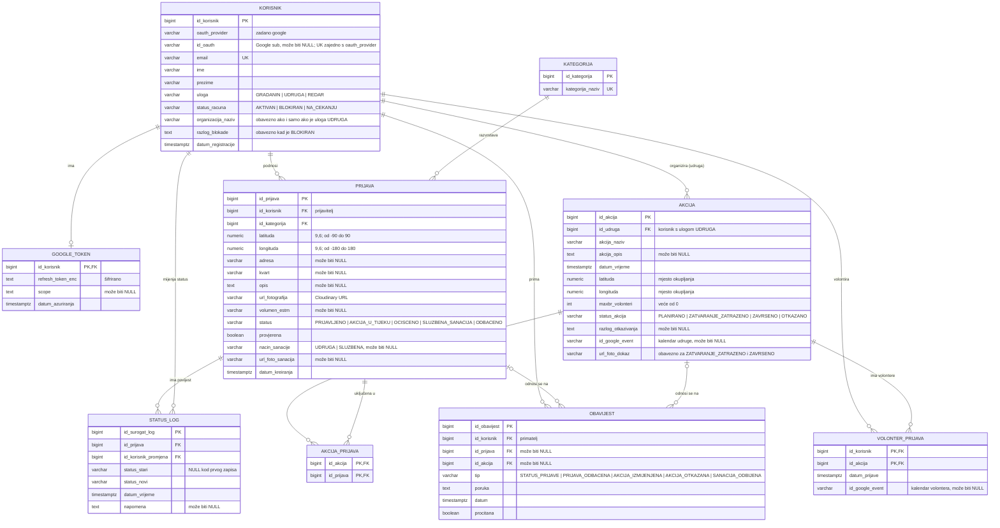

# ER dijagram baze EcoSentryDB

Dijagram prikazuje shemu baze **nakon migracija V1–V4**, sa svim stupcima. GitHub ga iscrta izravno iz ove datoteke. Za izvoz u sliku kod se može zalijepiti na [mermaid.live](https://mermaid.live).

Sažeta verzija (samo ključni atributi) nalazi se u arhitekturi: [4.3.1 ER dijagram i model podataka](../docs/4-Arhitektura-i-oblikovanje.md), izvor [`4-2-ecosentry-data-ERD.puml`](../docs/puml/4-2-ecosentry-data-ERD.puml). Kad nova migracija promijeni tablice ili veze, treba ažurirati oba dijagrama.

**Oznake:** `PK` primarni ključ, `FK` strani ključ, `UK` jedinstvena vrijednost. Komentar uz stupac navodi dopuštene vrijednosti (`CHECK`) ili napomenu. Stupci bez `NOT NULL` u komentaru označeni su s „može biti NULL".

## Veze

| # | Veza | Kardinalnost | Realizacija | Značenje |
| --- | --- | --- | --- | --- |
| 1 | `KORISNIK` podnosi `PRIJAVA` | 1 : N | `prijava.id_korisnik` → `korisnik` | Korisnik ima 0 ili više prijava, prijava ima točno jednog prijavitelja |
| 2 | `KATEGORIJA` razvrstava `PRIJAVA` | 1 : N | `prijava.id_kategorija` → `kategorija` | Prijava ima točno jednu kategoriju |
| 3 | `KORISNIK` ima `GOOGLE_TOKEN` | 1 : 0..1 | `google_token.id_korisnik` (PK i FK) | Najviše jedan token po korisniku; briše se zajedno s korisnikom (`ON DELETE CASCADE`) |
| 4 | `KORISNIK` (udruga) organizira `AKCIJA` | 1 : N | `akcija.id_udruga` → `korisnik` | Akciju organizira točno jedna udruga |
| 5 | `PRIJAVA` ima povijest `STATUS_LOG` | 1 : N | `status_log.id_prijava` → `prijava` | Svaka promjena statusa je jedan zapis |
| 6 | `KORISNIK` mijenja status u `STATUS_LOG` | 1 : N | `status_log.id_korisnik_promjena` → `korisnik` | Tko je promijenio status |
| 7 | `AKCIJA` obuhvaća `PRIJAVA` | M : N | spojna tablica `AKCIJA_PRIJAVA` | Akcija čisti jedno ili više odlagališta; odlagalište kroz vrijeme može biti u više akcija (npr. nakon otkazivanja) |
| 8 | `KORISNIK` volontira na `AKCIJA` | M : N | spojna tablica `VOLONTER_PRIJAVA` (+ `datum_prijave`, `id_google_event`) | Volonter na više akcija, akcija s više volontera |
| 9 | `KORISNIK` prima `OBAVIJEST` | 1 : N | `obavijest.id_korisnik` → `korisnik` | Obavijest ima točno jednog primatelja |
| 10 | `OBAVIJEST` se odnosi na `PRIJAVA` | N : 0..1 | `obavijest.id_prijava` (NULL dopušten) | Obavijest može, ali ne mora biti vezana uz prijavu |
| 11 | `OBAVIJEST` se odnosi na `AKCIJA` | N : 0..1 | `obavijest.id_akcija` (NULL dopušten) | Obavijest može, ali ne mora biti vezana uz akciju |

`KORISNIK` se u dijagramu pojavljuje u više uloga (prijavitelj, organizator, volonter, autor promjene statusa, primatelj obavijesti). Uloga je opisana nazivom veze, a ne zasebnim entitetom, jer je u bazi jedna tablica `korisnik` sa stupcem `uloga`.

## Što se promijenilo u odnosu na prvi dizajn

- Tablica `prijava` više nema stupac `nalog_broj` ni ograničenje `ck_prijava_nalog` (uklonjeno u `V3`).
- Dodan je stupac `prijava.nacin_sanacije`: redar odlučuje ide li prijava udrugama ili na službenu sanaciju.
- Svi identifikatori su `BIGINT` (Java `Long`).

Detaljan opis atributa i pravila je u [`db_dokumentacija.md`](db_dokumentacija.md).
