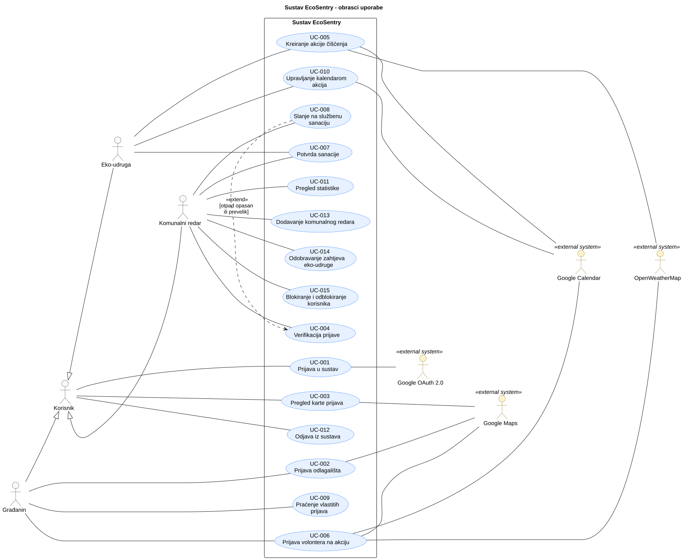

# 3. Obrasci uporabe

## 3.1 Dijagram obrazaca uporabe

**PlantUML izvor:** [izvor](./puml/3-1-ecosentry-system-UC.puml)
- Prijava u sustav (UC-001) je preduvjet ostalih obrazaca uporabe, a ne `<<include>>`, jer je korisnik prijavljen prije njihova početka.

## 3.2 Specifikacije obrazaca uporabe

### UC-001: Prijava u sustav

| Element specifikacije | Opis                                                                                                                                                                                                                                                                                                                                                                                                                                                                                                                                                                                                                                                                                                                                                                                                                                                                                                                                                                           |
| :--- |:-------------------------------------------------------------------------------------------------------------------------------------------------------------------------------------------------------------------------------------------------------------------------------------------------------------------------------------------------------------------------------------------------------------------------------------------------------------------------------------------------------------------------------------------------------------------------------------------------------------------------------------------------------------------------------------------------------------------------------------------------------------------------------------------------------------------------------------------------------------------------------------------------------------------------------------------------------------------------------|
| **Primarni akter** | Korisnik(Građanin, Eko-udruga, Komunalni redar)                                                                                                                                                                                                                                                                                                                                                                                                                                                                                                                                                                                                                                                                                                                                                                                                                                                                                                                                
|**Sekundarni akter** | Google (OAuth 2.0)                                                                                                                                                                                                                                                                                                                                                                                                                                                                                                                                                                                                                                                                                                                                                                                                                                                                                                                                                             
| **Povezani zahtjevi** | F-001, F-002, F-003, F-004                                                                                                                                                                                                                                                                                                                                                                                                                                                                                                                                                                                                                                                                                                                                                                                                                                                                                                                                                     |
| **Preduvjeti** | Korisnik nije prijavljen u sustav.                                                                                                                                                                                                                                                                                                                                                                                                                                                                                                                                                                                                                                                                                                                                                                                                                                                                                                                                             |
| **Glavni uspješni tok** | 1. Korisnik odabire opciju prijave u sustav pomoću Goolge računa. 2. Preusmjeravanje na Google OAuth 2.0. 3. Korisnik se autentificira pomoću Google računa. 4. Sustav nakon potvrde identiteta pronalazi njegov račun ili generira novi račun, ako ga korisniki nije imao prije. Korisniku se dodjeljuje njegova uloga.  5. Korisnik vidi web aplikaciju za koju ima pristup svojom ulogom.                                                                                                                                                                                                                                                                                                                                                                                                                                                                                                                                                                       |
| **Alternativni tokovi / Iznimke** | **1a — Prijava u sustav pomoću korisničkog imena i lozinke:** Administrator je kreirao korisnika(komunalnog redara) te mu je dodijelio korisničko ime, lozinku i email. Ako podatci nisu točni sustav prikazuje poruku.  **1b — Promjena lozinke:** Komunalni redar može promijeniti lozinku pomoću stare lozinke. Ako stara lozinka nije točna ne može se promijeniti.   **3a — Odustajanje od prijave na Google zaslonu:** Korisnik odustaje od prijave na Google zaslonu. Korisnik se može ponovno pokušati prijaviti na početnoj stranici. Ne dodjeljuje mu se nikakva uloga.   **4a — Korisnik je blokiran:** Korisniku se prikazuje razlog blokade. Korisniku je onemogućeno podnošenje prijava i akcija.   **4b — Udruga još nije odobrena:** Predstavnik udruge ima račun, ali nema prava udruge. Nudi se mogućnost slanja zahtjeva za stvaranje udruge ili status da je već zatraženo stvaranje udruge. Ovisno o redaru korisnik dobiva ulogu Eko-udruga. |
| **Posljedice (ishod)** | Korisnik je prijavljen i vidi dio aplikacije koje mu njegova uloga dozvoljava. Korisnik nije uspješno prijavljen, može ponovno pokušati prijavu.                                                                                                                                                                                                                                                                                                                                                                                                                                                                                                                                                                                                                                                                                                                                                                                                                               |

### UC-002: Prijava odlagališta

| Element specifikacije | Opis                                                                                                                                                                                                                                                                                                                                                                                                                                                                                                                                                   |
| :--- |:-------------------------------------------------------------------------------------------------------------------------------------------------------------------------------------------------------------------------------------------------------------------------------------------------------------------------------------------------------------------------------------------------------------------------------------------------------------------------------------------------------------------------------------------------------|
| **Primarni akter** | Građanin                                                                                                                                                                                                                                                                                                                                                                                                                                                                                                                                               
|**Sekundarni akter** | Google Maps                                                                                                                                                                                                                                                                                                                                                                                                                                                                                                                                            
| **Povezani zahtjevi** | F-006, F-007, F-008, F-014                                                                                                                                                                                                                                                                                                                                                                                                                                                                                                                             |
| **Preduvjeti** | Građanin je prijavljen i nije blokiran.                                                                                                                                                                                                                                                                                                                                                                                                                                                                                                                |
| **Glavni uspješni tok** | 1. Građanin otvara novu prijavu. 2. Sustav traži dopuštenje za korištenje lokacije i postavlja pribadaču na trenutnu GPS lokaciju.  3. Mogućnost promjene lokacije pribadače ručno na karti.  4. Građanin dodaje fotografiju pomoću kamere ili iz galerije.   5. Odabire se kategorija otpada(plastika, građevinski, glomazni, ostalo) i podnosi se prijava.   6. Sustav provjerava da je sve potrebno uneseno(lokacija, fotografija, kategorija).   7. Sustav sprema prijavu. Prijava dobiva ID i status Prijavljeno.               |
| **Alternativni tokovi / Iznimke** | **2a — Građanin nije dopustio lokacijue:** Korisnik nije dopustio lokaciju pa postavlja lokaciju ručno. Postavlja odabirom na karti ili upisom adrese.   **4a — Neispravna fotografija:** Sustav prihvaća samo slikovne datoteke (JPG, PNG) do 10 MB. [NF-05]   **6a — Nedostaje lokacija, kategorija ili fotografija:** Sustav ne sprema prijavu, već označava što nedostaje i ostavlja već unesene podatke. Građanin mora unesti tražene podatke   **7a — Pohrana nije uspjela:** Prikazuje se poruka o pogrešci i ne prikazuje se potvrda. |
| **Posljedice (ishod)** | Prijava je spremljena sa statusom Prijavljeno i ID-em, pojavljuje se kao crvena pribadača na karti.                                                                                                                                                                                                                                                                                                                                                                                                                                                    |

### UC-003: Pregled karte prijava

| Element specifikacije | Opis                                                                                                                                                                                                                                                                                                                                                                                                                              |
| :--- |:----------------------------------------------------------------------------------------------------------------------------------------------------------------------------------------------------------------------------------------------------------------------------------------------------------------------------------------------------------------------------------------------------------------------------------|
| **Primarni akter** | Korisnik(Građanin, Eko-udruga, Komunalni redar)                                                                                                                                                                                                                                                                                                                                                                                   
|**Sekundarni akter** | Google Maps                                                                                                                                                                                                                                                                                                                                                                                                                       
| **Povezani zahtjevi** | F-011, F-012, F-013                                                                                                                                                                                                                                                                                                                                                                                                               |
| **Preduvjeti** | Nema preduvjeta                                                                                                                                                                                                                                                                                                                                                                                                                   |
| **Glavni uspješni tok** | 1. Korisnik otvara kartu. 2. Sustav prikazuje prijave na Google karti kao pribadače obojane po statusu (crveno - Prijavljeno, žuto - Akcija u tijeku, zeleno - Očišćeno). 3. Korisnik odabire pribadaču(prijavu).  4. Sustav prikazuje detalje prijave: fotografija, kategorija, adresa, status i datum.                                                                                                                 |
| **Alternativni tokovi / Iznimke** | **2a — Nema prijava u tom području:** Sustav prikazuje kartu bez pribadača s porukom da nema prijava u tom području.   **2b — Karta se ne učita:** Sustav obavještava da karta nije trenutno dostupna, dok ostatak aplikacije radi. [NF-06]  **4a — Adresa nije dostupna:** Iz koordinata se ne može odrediti adresa. Pa se umjesto adrese prikazuju samo koordinate.                                                       |
| **Posljedice (ishod)** | Korisnik vidi prijave na karti s njihovim stanjima.                                                                                                                                                                                                                                                                                                                                                                               |

### UC-004: Verifikacija prijave

| Element specifikacije | Opis                                                                                                                                                                                                                                                                                                                                                                                                                                                                                                                                                                                                                                                      |
| :--- |:----------------------------------------------------------------------------------------------------------------------------------------------------------------------------------------------------------------------------------------------------------------------------------------------------------------------------------------------------------------------------------------------------------------------------------------------------------------------------------------------------------------------------------------------------------------------------------------------------------------------------------------------------------|
| **Primarni akter** | Komunalni redar                                                                                                                                                                                                                                                                                                                                                                                                                                                                                                                                                                                                                                           |
| **Povezani zahtjevi** | F-016, F-017, F-005                                                                                                                                                                                                                                                                                                                                                                                                                                                                                                                                                                                                                                       |
| **Preduvjeti** | Postoji neprovjerena prijava.                                                                                                                                                                                                                                                                                                                                                                                                                                                                                                                                                                                                                             |
| **Glavni uspješni tok** | 1. Redar otvara popis novih prijava. 2. Sustav prikazuje neprovjerene prijave s ostalim detaljima. 3. Redar odabire prijavu i pregledava podatke.  4. Redar prihvaća prijavu.  5. Sustav označava prijavu kao provjerenu. Prijava se pojavljuje udrugama kao dostupna za akciju čišćenja.                                                                                                                                                                                                                                                                                                                                                     |
| **Alternativni tokovi / Iznimke** | **3a — Pogrešna kategorija otpada:** Redar mijenja kategoriju otpada.   **4a — Lažna prijava:** Redar odbacuje prijavu.(fotografija nema smisla, duplikat, ista lokacija već prijavljena lokacija). **4b — Blokiranje korisnika:** Određeni korisnik šalje lažne prijave. Redar ga blokira uz određeni razlog. Blokada se može maknuti.  **4c — Otpad je opasan ili prevelik za volontere:** Nakon prihvaćanja redar izdaje službeni nalog(UC-008).                                                                                                                                                                                              |
| **Posljedice (ishod)** | Prijava je prihvaćena i dostupna udrugama za akciju čišćenja ili je odbačena i nije vidljiva na karti. Ako je redar izdao službeni nalog (proširenje UC-008), prijava ima status Službena sanacija i nije dostupna za akciju.                                                                                                                                                                                                                                                                                                                                                                                                                             |

### UC-005: Kreiranje akcije čišćenja

| Element specifikacije | Opis                                                                                                                                                                                                                                                                                                                                                                                                                                                                                                                                                                                                                                                                                                                                                                                                                                                                               |
| :--- |:-----------------------------------------------------------------------------------------------------------------------------------------------------------------------------------------------------------------------------------------------------------------------------------------------------------------------------------------------------------------------------------------------------------------------------------------------------------------------------------------------------------------------------------------------------------------------------------------------------------------------------------------------------------------------------------------------------------------------------------------------------------------------------------------------------------------------------------------------------------------------------------|
| **Primarni akter** | Eko-udruga                                                                                                                                                                                                                                                                                                                                                                                                                                                                                                                                                                                                                                                                                                                                                                                                                                                                         
| **Sekundarni akter** | Google Calendar, OpenWeatherMap                                                                                                                                                                                                                                                                                                                                                                                                                                                                                                                                                                                                                                                                                                                                                                                                                                                    
| **Povezani zahtjevi** | F-021, F-028, F-031, F-032                                                                                                                                                                                                                                                                                                                                                                                                                                                                                                                                                                                                                                                                                                                                                                                                                                                         |
| **Preduvjeti** | Udruga mora biti odobrena. Mora postojati provjerena prijava u statusu Prijavljeno.                                                                                                                                                                                                                                                                                                                                                                                                                                                                                                                                                                                                                                                                                                                                                                                                |
| **Glavni uspješni tok** | 1. Udruga na karti odabire jednu ili više prijava. 2. Udruga upisuje naziv, opis, najveći broj volontera, datum, vrijeme i mjesto okupljanja. 3. Sustav prikazuje prognozu za lokaciju akcije na dati datum pomoću OpenWeatherMapa. 4. Udruga potvrđuje kreiranje akcije.  5. Sustav mijenja status odabranih prijava u Akcija u tijeku i prikazuje akcije u kalendaru udruge. 6. Sustav u Google kalendaru udruge stvara događaj s terminom, poveznicom na lokaciju na karti, kratkim uputama i podsjetnikom 2 sata prije početka.                                                                                                                                                                                                                                                                                                                                 |
| **Alternativni tokovi / Iznimke** | **1a — Prijava nije dostupna za akciju:** Prijava ima status Službena sanacija ili prijava je već u drugoj akciji.  **2a — Nedostaju podaci ili je termin u prošlosti:** Sustav ne sprema akciju i traži nadopunu.  **3a — Prognoza još nije dostupna:** Ako je akcija predaleko u budućnosti [AS-03] ili OpenWeatherMap ne odgovara, sustav prikazuje poruku da prognoza još nije dostupna i tok se nastavlja. [NF-06]  **3b — Najavljeno nevrijeme:**  Ako prognoza pokazuje jaku kišu, oluju, temperaturu iznad 35 °C ili ispod 0 °C [AS-04], sustav prikazuje crveno upozorenje i nudi brzu promjenu termina. Udruga odabire novi datum ili vrijeme. **6a — Organizator ne dopusti pristup kalendaru:** Organizator ne dozvoljava pristup svom Google kalendaru. Akcija se ipak sprema, a sustav prikazuje poruku da događaj nije upisan u Google kalendar. [C-04] |
| **Posljedice (ishod)** | Akcija postoji u sustavu i u kalendaru udruge, a odabrane prijave imaju status Akcija u tijeku (žute pribadače).                                                                                                                                                                                                                                                                                                                                                                                                                                                                                                                                                                                                                                                                                                                                                                   |

### UC-006: Prijava volontera na akciju

| Element specifikacije | Opis                                                                                                                                                                                                                                                                                                                                                                                                                                                                                                                                                                                                                                                                                                                               |
| :--- |:-----------------------------------------------------------------------------------------------------------------------------------------------------------------------------------------------------------------------------------------------------------------------------------------------------------------------------------------------------------------------------------------------------------------------------------------------------------------------------------------------------------------------------------------------------------------------------------------------------------------------------------------------------------------------------------------------------------------------------------|
| **Primarni akter** | Građanin                                                                                                                                                                                                                                                                                                                                                                                                                                                                                                                                                                                                                                                                                                                           |
|**Sekundarni akter**| Google Calendar, Google Maps, OpenWeatherMap                                                                                                                                                                                                                                                                                                                                                                                                                                                                                                                                                                                                                                                                                       
| **Povezani zahtjevi** | F-026, F-029, F-027, F-015, F-031                                                                                                                                                                                                                                                                                                                                                                                                                                                                                                                                                                                                                                                                                                  |
| **Preduvjeti** | Građanin nije blokiran                                                                                                                                                                                                                                                                                                                                                                                                                                                                                                                                                                                                                                                                                                             |
| **Glavni uspješni tok** | 1. Građanin otvara popis nadolazećih akcija čišćenja. 2. Sustav prikazuje akcije s datumom, mjestom okupljanja i popunjenošću. 3. Građanin odabire akciju. Sustav prikazuje detalje i prognozu za dan akcije. 4. Građanin se prijavljuje na akciju. 5. Sustav sprema prijavu volontera i povećava broj volontera za jedan. 6. Sustav u Google kalendaru građanina stvara događaj s terminom, poveznicom na lokaciju, kratkim uputama i podsjetnikom 2 sata prije početka. 7. Na dan akcije volonter u detaljima akcije otvara kartu, a sustav prikazuje mjesto okupljanja i rutu od njegove trenutne lokacije.                                                                                                   |
| **Alternativni tokovi / Iznimke** | **3a — Prognoza nije dostupna ili je najavljeno nevrijeme:** Sustav prikazuje poruku o nedostupnosti prognoze ili crveno upozorenje o nevremenu. Građanin se i dalje može prijaviti.   **4a — Akcija je popunjena:** Sustav ne dopušta prijavu i prikazuje da je akcija popunjena. **4b — Odjava s akcije:** Građanin je već prijavljen na akciju. Ponovnim pokušajem prijave nudi se mogućnost odjavljivanja s akcije.  **6a — Volonter ne dopusti pristup kalendaru:** U sustavu je spremljena prijava na akciju, sustav prikazuje poruku da akcija nije upisana u kalendar.   **7a — Pristup lokaciji odbijen:** Građanin nije dozvolio pristup lokaciji. Na karti se samo pojavljuje lokacija okupljanja bez rute. |
| **Posljedice (ishod)** | Građanin je prijavljen kao volonter, broj volontera je veći za jedan, a akcija je u njegovu kalendaru. Nakon odjave broj volontera je manji i događaj je uklonjen.

### UC-007: Potvrda sanacije

| Element specifikacije | Opis                                                                                                                                                                                                                                                                                                                                                                                                   |
| :--- |:-------------------------------------------------------------------------------------------------------------------------------------------------------------------------------------------------------------------------------------------------------------------------------------------------------------------------------------------------------------------------------------------------------|
| **Primarni akter** | Eko-udruga, Komunalni redar                                                                                                                                                                                                                                                                                                                                                                            |
| **Povezani zahtjevi** | F-019, F-025                                                                                                                                                                                                                                                                                                                                                                                           |
| **Preduvjeti** | Prijava nije zatvorena ni odbačena. Ako sanaciju potvrđuje udruga, akcija je održana i prijava je u statusu Akcija u tijeku.                                                                                                                                                                                                                                                                           |
| **Glavni uspješni tok** | 1. Nakon akcije udruga otvara akciju i učitava fotografiju očišćene lokacije kao dokaz o sanaciji. 2. Udruga šalje zahtjev za zatvaranje prijave. 3. Sustav sprema zahtjev i prikazuje ga redaru. 4. Redar pregledava zahtjev i fotografiju i potvrđuje sanaciju. 5. Sustav mijenja status prijave u Očišćeno (zelena pribadača) i šalje obavijest prijavitelju.                           |
| **Alternativni tokovi / Iznimke** | **1a — Redar sam zatvara prijavu**Redar otvara prijavu te učitava fotografiju očišćene lokacije i potvrđuje zatvaranje. Tok se nastavlja u koraku 5. **1b — Fotografija nije učitana ili je neispravna:** Sustav ne šalje zahtjev i prikazuje poruku.[NF-05] **4a — Redar odbije dokaz o sanaciji:** Prijava ostaje u statusu Akcija u tijeku i udruga dobiva obavijest da sanacija nije potvrđena. |
| **Posljedice (ishod)** | Prijava ima status Očišćeno i prijavitelj je obaviješten, ili prijava ostaje nepromijenjena.                                                                                                                                                                                                                                                                                                           |

### UC-008: Izdavanje službenog naloga

| Element specifikacije | Opis                                                                                                                                                                                         |
| :--- |:---------------------------------------------------------------------------------------------------------------------------------------------------------------------------------------------|
| **Primarni akter** | Komunalni redar                                                                                                                                                                              |
| **Povezani zahtjevi** | F-018                                                                                                                                                                                        |
| **Preduvjeti** | Prijava je prihvaćena(UC-004) i nije dodana u akciju čišćenja.                                                                                                                               |
| **Glavni uspješni tok** | 1. Redar otvara prijavu opasnog ili prevelikog otpada. 2. Redar odabire izdavanje službenog naloga. 3. Sustav generira nalog s ID-em, lokacijom, adresom, kategorijom i fotografijama. |
| **Posljedice (ishod)** | Prijava ima status Službena sanacija, nalog je spremljen u sustavu, a udruge prijavu više ne mogu dodati u akciju.                                                                                                                             |

### UC-009: Praćenje vlastitih prijava

| Element specifikacije | Opis                                                                                                                                                                                                                                                                                                                                        |
| :--- |:--------------------------------------------------------------------------------------------------------------------------------------------------------------------------------------------------------------------------------------------------------------------------------------------------------------------------------------------|
| **Primarni akter** | Građanin                                                                                                                                                                                                                                                                                                                                    |
| **Povezani zahtjevi** | F-009, F-010                                                                                                                                                                                                                                                                                                                                |
| **Preduvjeti** | Nema.                                                                                                                                                                                                                                                                                                                                       |
| **Glavni uspješni tok** | 	1. Pri otvaranju aplikacije sustav prikazuje broj novih obavijesti o promjeni statusa građaninovih prijava. 2. Građanin otvara popis svojih prijava. 3. Sustav prikazuje sve njegove prijave s trenutnim statusom i označava one čiji se status promijenio. 4. Građanin otvara prijavu i vidi njezine detalje i povijest statusa. 
| **Alternativni tokovi / Iznimke** | **2a — Građanin nema prijava:** Sustav prikazuje prazan popis.                                                                                                                                                                                                                                                                              |
| **Posljedice (ishod)** | Građanin vidi status svake svoje prijave, a obavijesti su označene kao pročitane. Obavijesti postoje samo unutar aplikacije.                                                                                                                                                                                                                |

### UC-010: Upravljanje kalendarom akcija

| Element specifikacije | Opis                                                                                                                                                                                                                                                                                                                                                                                                                                                                                                                                                                                                                                                 |
| :--- |:-----------------------------------------------------------------------------------------------------------------------------------------------------------------------------------------------------------------------------------------------------------------------------------------------------------------------------------------------------------------------------------------------------------------------------------------------------------------------------------------------------------------------------------------------------------------------------------------------------------------------------------------------------|
| **Primarni akter** | Eko-udruga                                                                                                                                                                                                                                                                                                                                                                                                                                                                                                                                                                                                                                           
Sekundarni akter| Google Calendar                                                                                                                                                                                                                                                                                                                                                                                                                                                                                                                                                                                                                                      
| **Povezani zahtjevi** | F-022, F-023, F-024, F-030, F-032                                                                                                                                                                                                                                                                                                                                                                                                                                                                                                                                                                                                                    |
| **Preduvjeti** | Udruga ima barem jednu akciju.                                                                                                                                                                                                                                                                                                                                                                                                                                                                                                                                                                                                                       |
| **Glavni uspješni tok** | 1. Udruga otvara kalendar akcija. 2. Sustav prikazuje sve akcije udruge na njihovim datumima s brojem prijavljenih i najvećim brojem volontera. 3. Udruga odabire akciju koja još nije održana i mijenja naziv, opis, najveći broj volontera, datum ili vrijeme. 4. Sustav sprema izmjene i šalje obavijest prijavljenim volonterima. 5. Ako je promijenjen termin, sustav ažurira događaje u Google kalendarima udruge i volontera.                                                                                                                                                                                                     |
| **Alternativni tokovi / Iznimke** | **3a — Otkazivanje akcije:** Udruga otkazuje akciju i potvrđuje otkazivanje. Sustav vraća prijave iz akcije u status Prijavljeno i šalje obavijest prijavljenim volonterima.   **3b — Odgoda zbog nevremena:** Kod akcije za koju je najavljeno nevrijeme sustav prikazuje crveno upozorenje. Udruga iz upozorenja odabire novi termin i tok se nastavlja u koraku 4.   **3c — Najveći broj volontera manji je od broja već prijavljenih:** Sustav ne sprema izmjenu i prikazuje poruku.   **5a — Kalendar se ne može ažurirati:** Izmjena je spremljena u sustavu, a sustav prikazuje poruku da događaj u kalendaru nije ažuriran. [NF-06] |
| **Posljedice (ishod)** | Akcija ima nove podatke ili je otkazana, volonteri su obaviješteni, a događaji u kalendarima prikazuju novi termin.                                                                                                                                                                                                                                                                                                                                                                                                                                                                                                                                  |

### UC-011: Pregled statistike

| Element specifikacije | Opis                                                                                                                                           |
| :--- |:-----------------------------------------------------------------------------------------------------------------------------------------------|
| **Primarni akter** | Komunalni redar                                                                                                                                |
| **Povezani zahtjevi** | F-020                                                                                                                                          |
| **Preduvjeti** | Nema.                                                                                                                                          |
| **Glavni uspješni tok** | 1. 	Redar otvara statistiku i odabire razdoblje. 2. Sustav prikazuje broj prijava po mjesecima i postotak riješenih prijava za to razdoblje |
| **Alternativni tokovi / Iznimke** | **2a — Nema podataka za razdoblje:** Sustav prikazuje poruku da u odabranom razdoblju nema prijava.                                                       |
| **Posljedice (ishod)** | Redar vidi statistiku. Podaci se ne mijenjaju.                                                                                                 
|

## 3.3 Provjera dosljednosti obrazaca uporabe

| Provjera | Rezultat provjere                                                                                                           |
| --- |-----------------------------------------------------------------------------------------------------------------------------|
| Zahtjev | Svaki UC povezan je s barem jednim zahtjevom iz 2.1, a svi zahtjevi Must i Should (F-001 do F-032) pokriveni su barem jednim UC-om. Zahtjevi Won't (F-033 do F-036) nisu obuhvaćeni.                                                           |
| Akter |Primarni akteri su A-01 do A-03, a sekundarni A-04 do A-07 iz 2.3. Komunalna tvrtka (D-01) nije akter jer ne koristi aplikaciju.                                         |
| Aplikacija |Obrasci uporabe opisuju planirano ponašanje sustava. Obrasci UC-001 do UC-007 i UC-009 pokrivaju zahtjeve s prioritetom Must (MVP iz poglavlja 2) i bit će prvi implementirani. UC-008, UC-010 i UC-011 većinom pokrivaju zahtjeve s prioritetom Should. |