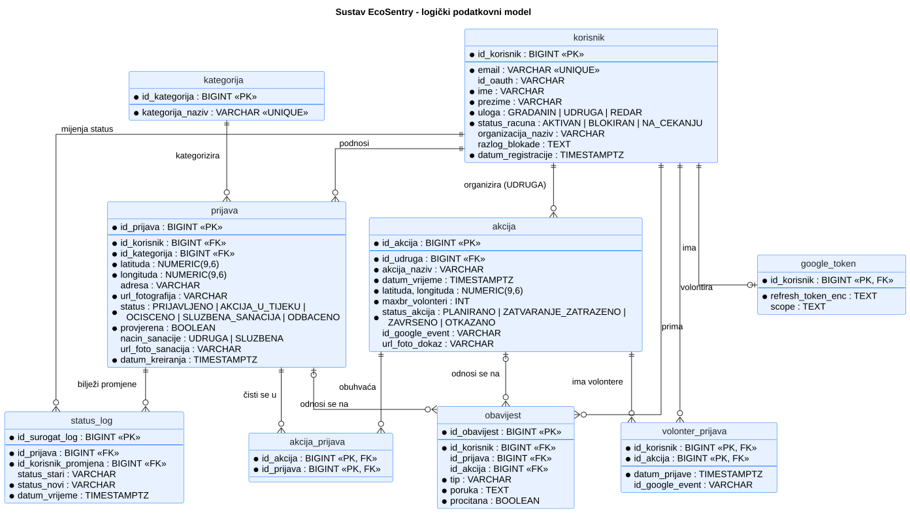
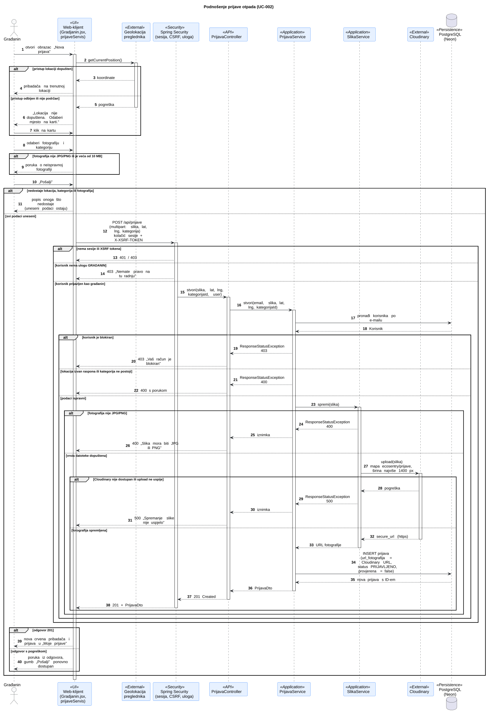
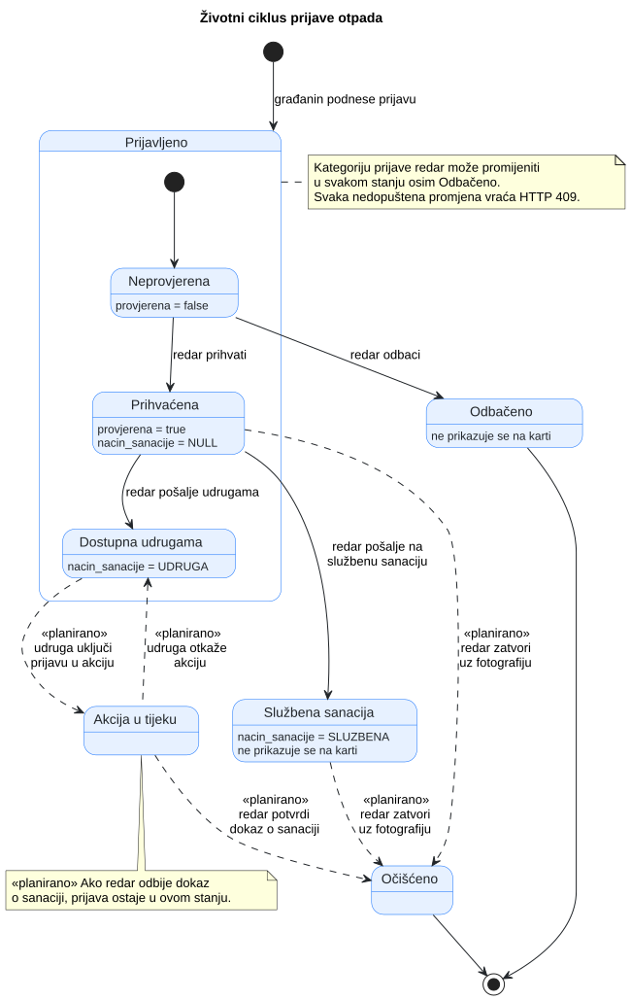

# 4. Arhitektura i oblikovanje

| Arhitekturni pogled | Ključno inženjersko pitanje | Primijenjeni model ili dijagram |
| :--- | :--- | :--- |
| **Strategija rješenja** | Koji stil i temeljne odluke određuju program? | Tablica odluka (odjeljak 4.1) |
| **Struktura podsustava** | Koji su glavni dijelovi i kako komuniciraju? | Dijagram komponenata |
| **Model podataka** | Kako su strukturirani trajni podaci programa? | Relacijski ER dijagram |
| **Struktura koda** | Kako su dodijeljene odgovornosti i ključne klase? | Reprezentativni dijagram razreda |
| **Dinamičko ponašanje** | Kako moduli surađuju pri obradi ključnih transakcija? | sekvencijski dijagram |
| **Stanja sustava** | Kako ključni domenski objekt mijenja svoja stanja? | Dijagram stanja |
| **Fizički razmještaj** | Na kojim se izvršnim čvorovima program izvodi? | Dijagram razmještaja (poglavlje 6) |

---

## 4.1 Ključne arhitekturne odluke

| Odluka                                                                                                                                                                              | Razmatrana alternativa | Projektno specifično obrazloženje i kompromis |
|-------------------------------------------------------------------------------------------------------------------------------------------------------------------------------------| --- | --- |
| Svi korisnici prijavljuju se isključivo Google računom (OAuth 2.0 / OpenID Connect); poslužitelj pamti prijavljenog korisnika u sesiji, a ulogu čita iz baze                        | Lokalni računi s lozinkom za komunalne redare | Sustav ne sprema ni ne provjerava lozinke, a uloga se ne preuzima od Googlea nego iz vlastite baze, pa poslužitelj odlučuje o pravima. Ovisimo o dostupnosti Googlea, a prvog redara treba upisati izravno u bazu. Obrazloženje je u ADR-01. |
| PostgreSQL kod upravljanog pružatelja Neon                                                                                                                                          | MySQL; Supabase kao pružatelj baze | Prijave, korisnici, kategorije i akcije imaju jasne veze i ograničenja koja relacijska shema čini eksplicitnima. Neon nudi samo bazu, što odgovara aplikaciji u kojoj prijavu i API već radi Spring Boot. Besplatna baza se uspava kad nema prometa, pa prvi upit nakon pauze traje duže. Obrazloženje je u ADR-02. |
| Shemu baze vode Flyway migracije (`V1__init.sql` … `V4__test_racuni.sql`), a Hibernate je samo provjerava (`ddl-auto=validate`)                                                     | Ručno izvršavanje SQL skripti u pgAdminu | Baza je zajednička za sve članove tima i za Render, a za nju je zadužen jedan član. Svaka promjena sheme je nova datoteka u repozitoriju i automatski se primjenjuje pri pokretanju poslužitelja, pa svi imaju istu shemu i povijest promjena. Kompromis: izvršena migracija se ne smije mijenjati, nego se svaka ispravka piše kao nova migracija. |
| Fotografije prijava spremaju se izvan baze, u bazi je samo URL; fotografije se spremaju na Cloudinary                                                                               | Spremanje fotografija u bazu (`BYTEA`) | Baza ostaje mala unutar besplatne kvote Neona, a fotografije se mogu dohvaćati izravno putem URL-a.  Obrazloženje je u ADR-03. |
| Klijent i poslužitelj grade se i postavljaju kao jedna aplikacija: izgrađeni React klijent kopira se u Spring Boot aplikaciju, koja se postavlja kao jedna Docker usluga na Renderu | Odvojeno postavljanje klijenta i poslužitelja nije posebno razmatrano | Klijent i API dijele istu adresu, pa kolačić sesije i CSRF zaštita rade bez dodatne CORS konfiguracije, a za postavljanje je dovoljna jedna besplatna usluga i jedan `Dockerfile`. Kompromis: klijent se ne može postaviti neovisno o poslužitelju, a kvar ili ponovno pokretanje usluge zaustavlja oboje. |

## 4.2 Gradivni blokovi i UML dijagram komponenata

Sustav EcoSentry čine web-klijent u Reactu, jedna poslužiteljska aplikacija u Spring Bootu i PostgreSQL baza na Neonu. Klijent i poslužitelj grade se i postavljaju zajedno (vidi 4.1), ali su logički odvojeni: klijent komunicira s poslužiteljem samo putem REST API-ja na `/api/...`. Pravokutnici unutar poslužiteljske aplikacije prikazuju module jedne aplikacije, a ne zasebno postavljene usluge. Isprekidano su prikazani dijelovi koji su planirani, ali još nisu implementirani.

**Slika 4.1. Dijagram komponenata sustava EcoSentry**

**PlantUML izvor:** [izvor](./puml/4-1-ecosentry-system-CMP.puml)

| Komponenta | Odgovornost                                                                                                                                                                                                                                                                 | Razlog za ovu granicu |
| --- |-----------------------------------------------------------------------------------------------------------------------------------------------------------------------------------------------------------------------------------------------------------------------------| --- |
| Stranice po ulogama (`frontend/src/pages`) | Nakon prijave `App.jsx` prema ulozi korisnika prikazuje stranicu `Gradjanin`, `KomunalniRedar` ili `EkoUdruga`; neprijavljeni korisnik vidi stranicu `Prijava`. Popis akcija na stranici `EkoUdruga` još prikazuje probne podatke, dok su prijave dohvaćene s poslužitelja. | Svaka uloga ima vlastiti prikaz i radnje, pa se stranice mogu razvijati neovisno. |
| Komponenta karte (`KartaPrijava.jsx`) | Prikazuje prijave kao pribadače obojane po statusu i omogućuje odabir lokacije nove prijave.                                                                                                                                                                                | Kartu koriste sve tri uloge; Google Maps ključ i rad s kartom nalaze se na jednom mjestu. |
| Klijentski servisi (`frontend/src/services`) | Šalju zahtjeve poslužitelju s kolačićem sesije i XSRF tokenom te pretvaraju pogreške u poruke za korisnika.                                                                                                                                                                 | Stranice ne znaju adrese ni oblik HTTP zahtjeva; rad s podacima odvojen je od prikaza. |
| Sigurnost i prijava (`SecurityConfig`, `CustomOidcUserService`) | Provodi Google prijavu, pronalazi ili stvara korisnika u bazi i dodjeljuje mu ulogu; štiti sve rute `/api/**` osim prijave i provjere ispravnosti.                                                                                                                          | Provjera identiteta i uloge odvija se na jednom mjestu, prije nego zahtjev stigne do kontrolera. |
| REST API (`controller`) | Prima HTTP zahtjeve, provjerava ulogu (`@PreAuthorize`) i vraća JSON; `GreskeHandler` sve pogreške vraća u istom obliku `{"poruka": ...}`.                                                                                                                                  | HTTP sloj odvojen je od pravila obrade prijava. |
| Obrada prijava (`PrijavaService`) | Provjerava podatke nove prijave, određuje tko smije vidjeti koju prijavu i provodi dopuštene promjene statusa.                                                                                                                                                              | Pravila o prijavama imaju jedno mjesto odgovornosti i ne ovise o tome odakle zahtjev dolazi. |
| Pohrana fotografija (`SlikaService`) | Provjerava vrstu datoteke (JPG, PNG), šalje fotografiju na Cloudinary (mapa ecosentry/prijave, širina najviše 1400 px) i vraća secure_url.                                                                                                                                  |  Ostatak poslužitelja samo poziva `spremi(slika)` i dobiva URL, pa prelazak s diska na Cloudinary nije zahtijevao promjene u `PrijavaService`, kontroleru ni shemi baze (ADR-03) |
| Pristup podacima (`repository`) | Spring Data JPA repozitoriji za korisnike, prijave i kategorije.                                                                                                                                                                                                            | Upiti prema bazi odvojeni su od poslovne logike. |
| Akcije čišćenja i obavijesti (planirano) | Organizacija akcija, prijava volontera, upis u Google kalendar, prognoza za termin i obavijesti unutar aplikacije.                                                                                                                                                          | Tablice za te podatke već postoje u bazi (4.3.1), a kod se dodaje kao zaseban modul. |

Vanjske usluge nalaze se izvan granice sustava. Google prijavu i Cloudinary, na koji se spremaju fotografije prijava, poziva poslužitelj, a Google Maps JavaScript API izravno preglednik. Google Calendar i OpenWeatherMap još nisu povezani. Gdje se ti dijelovi stvarno izvode prikazuje [dijagram razmještaja](./6-Postavljanje-instalacija-i-konfiguracija.md).

## 4.3 Model podataka i oblikovanje razreda

### 4.3.1 ER dijagram i model podataka

Građanin podnese prijavu otpada s fotografijom, kategorijom i lokacijom. Komunalni redar je prihvati ili odbaci i odluči hoće li je čistiti eko-udruga ili komunalna tvrtka. Eko-udruga može u jednu akciju čišćenja uključiti više prijava, a građani se na akciju prijavljuju kao volonteri. Svaka promjena statusa prijave bilježi se u povijesti statusa, a korisnici o promjenama dobivaju obavijesti.

**Slika 4.2. ER dijagram podataka sustava EcoSentry**

**PlantUML izvor:** [izvor](./puml/4-2-ecosentry-data-ERD.puml)  
**Implementacija:** shema se stvara Flyway migracijama u [`backend/src/main/resources/db/migration`](../backend/src/main/resources/db/migration) (`V1__init.sql` do `V4__test_racuni.sql`); JPA entiteti nalaze se u paketu [`hr.fer.ecosentry.model`](../backend/src/main/java/hr/fer/ecosentry/model).

Važne odluke modela podataka:

- **Jedna tablica `korisnik` za sve uloge.** Uloga je stupac s vrijednostima `GRADANIN`, `UDRUGA` i `REDAR`. Naziv organizacije obavezan je samo za udruge, a razlog blokade samo za blokirane korisnike. Oba pravila provodi baza (`CHECK` ograničenja), ne samo poslužitelj.
- **Bez lozinki.** Poslužitelj korisnika pri prijavi pronalazi po e-mailu, pa se redari i udruge mogu unaprijed upisati migracijom i odmah pri prvoj prijavi imaju svoju ulogu (ADR-01). Stupac `id_oauth` predviđen je za Googleov stalni identifikator, ali ga poslužitelj još ne popunjava (vidi [dokumentaciju baze](../db/db_dokumentacija.md), 8.2).
- **Kategorije su zapisi u tablici**, a ne fiksne vrijednosti u kodu, pa redar može promijeniti kategoriju prijave, a popis se mijenja migracijom.
- **Statusi i uloge spremaju se kao tekstualni kodovi** (npr. `AKCIJA_U_TIJEKU`) koji odgovaraju Java enumima; prikazne nazive s dijakriticima određuje klijent.
- **Veze više-na-više** (akcija obuhvaća više prijava; korisnik volontira na više akcija) provedene su veznim tablicama `akcija_prijava` i `volonter_prijava`. Uz volontera se pamti i ID događaja u njegovom Google kalendaru.
- **`status_log` čuva povijest promjena statusa** prijave: tko je i kada promijenio status iz kojeg u koji.
- **Fotografije nisu u bazi**, nego samo njihovi URL-ovi (ADR-03).

**Razlike između modela i trenutačne implementacije:** shema baze napravljena je za cijeli odobreni opseg, a poslužitelj zasad koristi samo tablice `korisnik`, `kategorija` i `prijava`. Tablice `akcija`, `akcija_prijava`, `volonter_prijava`, `obavijest`, `status_log` i `google_token` postoje u bazi, ali još nemaju JPA entitete ni kod koji ih koristi. Status `AKCIJA_U_TIJEKU` stoga se još ne postavlja.

### 4.3.2 Reprezentativni UML dijagram razreda

Prikazano je područje obrade prijave otpada: od REST kontrolera preko usluge do entiteta i repozitorija. To je središnji dio aplikacije i dio koji je u cijelosti implementiran.

**Slika 4.3. Dijagram razreda za obradu prijave otpada**

**PlantUML izvor:** [izvor](./puml/4-3-ecosentry-domain-CD.puml)  
**Kod:** [`PrijavaController`](../backend/src/main/java/hr/fer/ecosentry/controller/PrijavaController.java), [`PrijavaService`](../backend/src/main/java/hr/fer/ecosentry/service/PrijavaService.java), [`Prijava`](../backend/src/main/java/hr/fer/ecosentry/model/Prijava.java)

Raspodjela odgovornosti:

- **`PrijavaController`** samo prevodi HTTP zahtjeve u pozive usluge i provjerava ulogu: prijavu može podnijeti samo građanin, a mijenjati samo redar (`@PreAuthorize`).
- **`PrijavaService`** sadrži pravila: koje prijave pojedina uloga vidi (odbačene i one na službenoj sanaciji vide samo redar i autor; udruga vidi samo prijave poslane udrugama), provjeru lokacije i kategorije pri podnošenju te dopuštene promjene u metodi `izmijeni`. Primjerice, prijavu se može poslati udrugama tek nakon što je redar prihvati, a odbačenoj prijavi ne može se mijenjati kategorija. Nedopuštena promjena vraća HTTP 409.
- **`Prijava`, `Korisnik` i `Kategorija`** su JPA entiteti koji odgovaraju tablicama iz 4.3.1. `Korisnik` blokadu postavlja zajedno s razlogom (`blokiraj(razlog)`, `odblokiraj()`), a baza odbija spremanje blokiranog korisnika bez razloga.
- **Repozitoriji** su sučelja; Spring Data JPA sam stvara njihove implementacije iz imena metoda.
- **DTO zapisi** (`PrijavaDto`, `PrijavaIzmjenaDto`) određuju što se šalje klijentu. Entitet se nikad ne vraća izravno, pa usluga može sakriti autora prijave korisnicima koji ga ne smiju vidjeti.
- Usluga sve ovisnosti prima kroz konstruktor (vidi 4.6).

Pravila prijelaza statusa nalaze se u `PrijavaService`, a ne u samom entitetu `Prijava`. Kad se dodaju akcije čišćenja i zatvaranje prijava, broj prijelaza će rasti, pa je jedna od mogućnosti premjestiti ta pravila u metode entiteta (npr. `prihvati()`, `odbaci()`).

## 4.4 Ponašanje tijekom izvođenja

### 4.4.1 Reprezentativni UML sekvencijski dijagram

**Scenarij:** Podnošenje prijave otpada (UC-002)

Građanin otvara obrazac za novu prijavu, a klijent odmah traži lokaciju uređaja. Nakon odabira fotografije i kategorije prijava se šalje poslužitelju, koji provjerava sesiju i ulogu, podatke prijave i fotografiju te sprema prijavu sa statusom Prijavljeno. Odabran je ovaj scenarij jer je glavni ulaz podataka u sustav i prolazi kroz sve slojeve iz 4.2. Usto pokazuje gdje se koja provjera provodi.

**Slika 4.4. Sekvencijski dijagram podnošenja prijave otpada**

**PlantUML izvor:** [izvor](./puml/4-4-ecosentry-report-submission-SD.puml)

**Grane koje dijagram prikazuje** (usporedivo s alternativnim tokovima UC-002):

| Grana | Gdje se provjerava | Što korisnik vidi | UC-002 |
| --- | --- | --- | --- |
| Pristup lokaciji odbijen | Klijent (API geolokacije preglednika) | Poruku i mogućnost odabira mjesta klikom na kartu | 2a |
| Fotografija nije JPG/PNG ili je veća od 10 MB | Klijent, a vrstu datoteke ponovno i poslužitelj (`SlikaService`) | Poruku o neispravnoj fotografiji | 4a |
| Nedostaje lokacija, kategorija ili fotografija | Klijent, prije slanja zahtjeva | Popis onoga što nedostaje; uneseni podaci ostaju | 6a |
| Korisnik nije prijavljen ili nije građanin | Spring Security (`@PreAuthorize("hasRole('GRADANIN')")`) | HTTP 401 ili 403 | preduvjet |
| Korisnik je blokiran | `PrijavaService.stvori` | HTTP 403 „Vaš račun je blokiran” | preduvjet |
| Spremanje fotografije ili prijave ne uspije | `SlikaService`, Cloudinary, baza | Poruku o pogrešci; potvrda se ne prikazuje | 7a |

Provjere na klijentu postoje radi brzog odgovora korisniku, ali se ne smatraju zaštitom. Poslužitelj ponovno provjerava lokaciju, kategoriju i vrstu fotografije, jer se zahtjev može poslati i mimo sučelja (vidi 4.6). Fotografija se šalje na Cloudinary tek kad su ostali podaci provjereni, kako na Cloudinaryju ne bi ostale slike od odbijenih prijava i nepotrebno trošile besplatnu kvotu. Upis adrese umjesto odabira na karti (također dio 2a) još nije implementiran, pa nije prikazan.

### 4.4.2 Reprezentativni UML dijagram stanja

**Vlasnik stanja i razlog odabira:** prijava otpada (`Prijava`). Stanje je zapisano u stupcu `prijava.status`, a unutar stanja Prijavljeno dodatno ga određuju stupci `provjerena` i `nacin_sanacije`. Prijelazi su važni jer određuju tko prijavu vidi na karti, smije li je udruga uključiti u akciju i što redar smije napraviti.

**Slika 4.5. Dijagram stanja prijave otpada**

**PlantUML izvor:** [izvor](./puml/4-5-ecosentry-report-SM.puml)

Stanje Prijavljeno prikazano je kao složeno stanje s tri podstanja jer u bazi postoji samo jedan status `PRIJAVLJENO`, a ponašanje se ipak razlikuje: neprovjerenu prijavu redar može prihvatiti ili odbaciti, prihvaćenu poslati udrugama ili na službenu sanaciju, a udruge vide samo prijave poslane njima. Odbačene prijave i prijave na službenoj sanaciji ne prikazuju se na karti; autor ih vidi među svojim prijavama, a redar može otvoriti njihove detalje.

Prijelazi nacrtani punom crtom implementirani su u `PrijavaService.izmijeni` ([kod](../backend/src/main/java/hr/fer/ecosentry/service/PrijavaService.java)): svaki pokušaj prijelaza koji nije prikazan na dijagramu, primjerice slanje neprihvaćene prijave udrugama ili odbacivanje već riješene prijave, vraća HTTP 409. Isprekidani prijelazi (akcija čišćenja, otkazivanje akcije i zatvaranje prijave) slijede zahtjeve F-018, F-020, F-022 i F-024 i još nisu implementirani.

## 4.5 Zapisi arhitekturnih odluka

| ID | Odluka | Razmatrana alternativa | Obrazloženje i kompromis | Status     |
| --- | --- | --- | --- |------------|
| ADR-01 | Prijava isključivo Google računom | Lokalni računi s lozinkom za redare | Nema pohrane lozinki; ovisnost o Googleu. | Prihvaćeno |
| ADR-02 | PostgreSQL na Neonu | MySQL; Supabase | Relacijske veze i ograničenja; baza se uspava bez prometa. | Prihvaćeno |
| ADR-03 | Fotografije izvan baze, na Cloudinaryju | Fotografije u bazi | Mala baza; fotografije se dohvaćaju izravno putem URL-a i ne gube se pri ponovnom postavljanju. | Prihvaćeno |

### ADR-01: Prijava isključivo Google računom

| Polje | Zapis odluke |
| --- | --- |
| Kontekst i cilj | Zadatak traži prijavu putem OpenID Connect / OAuth 2.0. Prva inačica zahtjeva predviđala je i lozinke za komunalne redare, čije račune kreira administrator, te promjenu lozinke. Trebalo je odlučiti hoće li sustav održavati dva načina prijave. |
| Kriteriji odluke | Sustav ne smije nesigurno pohranjivati pristupne podatke; prava korisnika moraju se provjeravati na poslužitelju; opseg mora biti izvediv unutar semestra. |
| Razmatrane alternative | **Google prijava za sve korisnike:** jedan način prijave, bez lozinki u sustavu. **Google prijava za građane i lozinke za redare:** odgovara doslovnom čitanju zadatka, ali zahtijeva pohranu i sigurno sažimanje lozinki, promjenu i oporavak lozinke. |
| Odluka i obrazloženje | Svi korisnici, uključujući redare, prijavljuju se Google računom. Dogovoreno je s asistentom u prvoj iteraciji (vidi povijest promjena u [2. Analiza zahtjeva](2-Analiza-zahtjeva.md)). Poslužitelj pri prijavi pronalazi ili stvara korisnika u bazi (`CustomOidcUserService`) i dodjeljuje mu ulogu iz baze; novog redara postojeći redar dodaje upisom njegove e-mail adrese (planirano; zasad se redar dodaje migracijom). Odrekli smo se rada bez Googlea: ako Google prijava nije dostupna, nitko se ne može prijaviti, a prvi redar upisuje se izravno u bazu. |
| Status | Prihvaćeno. |

### ADR-02: PostgreSQL na Neonu

| Polje | Zapis odluke |
| --- | --- |
| Kontekst i cilj | Aplikacija pohranjuje korisnike, prijave s lokacijama, kategorije, akcije i volontere. Baza mora biti dostupna svim članovima tima tijekom razvoja i javno postavljenoj aplikaciji, besplatno, najmanje do kraja siječnja. |
| Kriteriji odluke | Podaci imaju veze i pravila (npr. prijava ima autora i kategoriju, udruga mora imati naziv organizacije, blokirani korisnik mora imati razlog blokade) koja baza treba čuvati; besplatno korištenje; baza ne smije prestati raditi kad tim neko vrijeme ne radi na projektu; mali napor održavanja. |
| Razmatrane alternative | **MySQL:** relacijska baza sličnih mogućnosti; PostgreSQL ima bogatije provjere (`CHECK`), tipove i podršku u besplatnim upravljanim uslugama. **Supabase:** upravljani PostgreSQL uz vlastitu prijavu, pohranu datoteka i automatski API, koje aplikacija ne bi koristila jer to radi Spring Boot; besplatan projekt se nakon dulje neaktivnosti pauzira i treba ga ručno ponovno pokrenuti. **Neon:** samo upravljani PostgreSQL; nakon kratke neaktivnosti se uspava i sam se budi pri sljedećem upitu. |
| Odluka i obrazloženje | Odabran je PostgreSQL na Neonu. Relacijska shema čini veze između prijava, korisnika i akcija eksplicitnima, a Neon pokriva samo ono što aplikaciji treba i ne zahtijeva ručno ponovno pokretanje. Prihvaćeno je da prvi upit nakon pauze traje duže; zato bazen veza ne drži otvorene veze (`hikari.minimum-idle=0`). Shema se stvara Flyway migracijama. |
| Status | Prihvaćeno. |

### ADR-03: Fotografije izvan baze, na Cloudinaryju

| Polje | Zapis odluke                                                                                                                                                                                                                                                                                                                                                                                                                                                       |
| --- |--------------------------------------------------------------------------------------------------------------------------------------------------------------------------------------------------------------------------------------------------------------------------------------------------------------------------------------------------------------------------------------------------------------------------------------------------------------------|
| Kontekst i cilj | Svaka prijava ima fotografiju otpada (do 10 MB), a zatvaranje prijave i dokaz o sanaciji dodaju još fotografija. Trebalo je odlučiti gdje se fotografije trajno čuvaju.                                                                                                                                                                                                                                                                                            |
| Kriteriji odluke | Baza mora ostati unutar besplatne kvote Neona; fotografije moraju preživjeti ponovno postavljanje aplikacije; klijent ih mora moći prikazati putem URL-a.                                                                                                                                                                                                                                                                                                          |
| Razmatrane alternative | **Fotografije u bazi (`BYTEA`):** sve na jednom mjestu, ali brzo troši prostor besplatne baze i opterećuje upite. **Disk poslužitelja:** najjednostavnije, ali Render briše disk pri svakom novom postavljanju. **Vanjska usluga Cloudinary:** trajna pohrana i dostava slika putem URL-a, uz dodatnu integraciju i ključeve.                                                                                                                                      |
| Odluka i obrazloženje | U bazi se čuva samo URL fotografije (`url_fotografija`, `url_foto_sanacija`, `url_foto_dokaz`), a same fotografije spremaju se na Cloudinary. `SlikaService` provjerava vrstu datoteke, šalje fotografiju na Cloudinary i vraća njezin URL, koji se upisuje u bazu. U prvoj verziji fotografije su se privremeno spremale na disk poslužitelja; budući da baza čuva samo URL, prelazak na Cloudinary nije zahtijevao promjenu  sheme baze ni ostatka poslužitelja. |
| Status | Prihvaćeno i provedeno.                                                                                                                                                                                                                                                                                                                                                                                                                                            |

## 4.6 Zajednička pravila oblikovanja (engl. Cross-cutting concerns)

| Aspekt | Mehanizam | Pravilo                                                                                                                                                                                                                                                                                                                                                                                       | Mjesto primjene |
| --- | --- |-----------------------------------------------------------------------------------------------------------------------------------------------------------------------------------------------------------------------------------------------------------------------------------------------------------------------------------------------------------------------------------------------| --- |
| Sigurnost | Autentikacija i autorizacija na poslužitelju | Sve rute `/api/**` osim `/api/auth/**` i `/api/health` zahtijevaju prijavu. Ulogu za svaku radnju provjerava poslužitelj; skrivanje gumba u sučelju nije zaštita. Uloga se pri prijavi čita iz baze i dodaje korisniku kao `ROLE_GRADANIN`, `ROLE_UDRUGA` ili `ROLE_REDAR`.                                                                                                                   | `SecurityConfig`, `CustomOidcUserService`, `@PreAuthorize` na metodama `PrijavaController` (npr. samo `REDAR` smije mijenjati prijavu) |
| Sigurnost | Zaštita od CSRF-a | Poslužitelj šalje XSRF token u kolačiću, a klijent ga uz svaki zahtjev koji mijenja podatke vraća u zaglavlju `X-XSRF-TOKEN`. Zahtjev bez tokena se odbija.                                                                                                                                                                                                                                   | `SecurityConfig` (`csrf.spa()`), `prijaveServis.js` i `autentikacijaServis.js` |
| Sigurnost | Vidljivost podataka po ulozi | Odbačene prijave i prijave na službenoj sanaciji ne prikazuju se u zajedničkom popisu ni na karti; autor ih vidi među svojim prijavama, a redar može otvoriti njihove detalje. Udruga vidi samo prijave poslane udrugama; ime prijavitelja vidi samo redar i sam prijavitelj. Prijava koju korisnik ne smije vidjeti vraća 404, kao da ne postoji. Klijent nikad ne dobiva entitet, nego DTO. | `PrijavaService` (`smijeVidjetiPrijavu`, `smijeVidjetiPrijavitelja`), `PrijavaDto` |
| Sigurnost | Tajne izvan repozitorija | Lozinka baze, Google client secret, Cloudinary API secret i ključevi čitaju se iz varijabli okruženja (lokalno iz `backend/.env`, na Renderu iz postavki usluge) i nikad se ne commitaju.                                                                                                                                                                                                     | `application.properties` (`${DB_PASSWORD}`, `${GOOGLE_CLIENT_SECRET}`…), [6. Postavljanje](./6-Postavljanje-instalacija-i-konfiguracija.md) |
| Validacija podataka | Dvostruka provjera ulaza | Klijent provjerava podatke radi brze povratne informacije, a poslužitelj ih uvijek provjerava ponovno: koordinate u rasponu, postojeća kategorija, fotografija JPG/PNG do 10 MB.                                                                                                                                                                                                              | `Gradjanin.jsx`; `PrijavaService.stvori`, `SlikaService.spremi`, `spring.servlet.multipart.max-file-size` |
| Validacija podataka | Ograničenja u bazi | Pravila koja moraju vrijediti uvijek provodi i baza: dopuštene vrijednosti uloga i statusa, raspon koordinata, naziv organizacije za udrugu, razlog blokade, prijava u statusu nakon provjere mora biti provjerena.                                                                                                                                                                           | `CHECK` ograničenja u `V1__init.sql` |
| Obrada pogrešaka | Jedinstven oblik odgovora | Svaka pogreška vraća se kao JSON `{"poruka": "..."}` s odgovarajućim HTTP statusom (400 neispravan unos, 401 nije prijavljen, 403 nema pravo, 404 ne postoji, 409 nedopuštena promjena stanja). Klijent tu poruku prikazuje korisniku.                                                                                                                                                        | `GreskeHandler` (`@RestControllerAdvice`), `SecurityConfig` (401/403), `posaljiZahtjev` u `prijaveServis.js` |
| Upravljanje ovisnostima | Injektiranje ovisnosti kroz konstruktor | Kontroleri i usluge ne stvaraju same svoje ovisnosti (repozitorije, druge usluge), nego ih Spring predaje kroz konstruktor.                                                                                                                                                                                                                                                                   | `PrijavaController(PrijavaService)`, `PrijavaService(PrijavaRepository, KorisnikRepository, KategorijaRepository, SlikaService)` |
| Upravljanje shemom baze | Migracije | Shemu mijenjaju samo Flyway migracije; Hibernate samo provjerava da se entiteti poklapaju s bazom (`ddl-auto=validate`) i ne smije sam mijenjati tablice.                                                                                                                                                                                                                                     | `db/migration`, `application.properties` |
| Otpornost na vanjske usluge | Rad bez karte | Ako se Google Maps ne učita ili ključ nije ispravan, korisnik dobiva poruku, a popis prijava i ostatak stranice i dalje rade (NF-05).                                                                                                                                                                                                                                                         | `KartaPrijava.jsx` |

## 4.7 Arhitekturni rizici i tehnički dug

**Tehnički rizici i dug**

| Rizik ili kompromis | Posljedica | Odgovor na rizik |
| --- | --- | --- |
| Besplatne instance Rendera i Neona gase se ili uspavljuju bez prometa. | Prvo otvaranje aplikacije nakon pauze može trajati do dvije minute, a prvi upit prema bazi duže nego inače. | Prihvaćeno za opseg kolegija i navedeno u README-u. Bazen veza ne drži otvorene veze (`hikari.minimum-idle=0`), pa se veza nakon buđenja baze ponovno uspostavi. |
| Sesije prijavljenih korisnika čuvaju se u memoriji poslužitelja. | Nakon svakog novog postavljanja svi se korisnici moraju ponovno prijaviti. | Prihvaćeno; navedeno u README-u. |
| Jedna instanca aplikacije poslužuje i klijent i API. | Kvar ili ponovno pokretanje usluge zaustavlja cijelu aplikaciju. | Prihvaćeno u okviru projekta; nema pričuvne instance ni automatskog prebacivanja. |
| Popis prijava dohvaća se bez paginacije, a dio filtriranja (po ulozi, statusu) radi se u Javi nakon dohvata. | S velikim brojem prijava dohvat bi postao spor i opteretio klijent i poslužitelj. | Za broj prijava u projektu nije problem. Ako zatreba, filtriranje se premješta u upite repozitorija i dodaje paginacija. |
| Povijest promjena statusa (`status_log`) postoji u bazi, ali se još ne popunjava. | Za postojeće prijave ne postoji trag tko je i kada promijenio status. | Upis u `status_log` dodat će se zajedno s ostalim promjenama statusa (akcije, zatvaranje). |
| Baza ne sprječava da ista prijava bude u dvije akcije: primarni ključ `akcija_prijava` je par (akcija, prijava). | Kad se akcije implementiraju, prijava bi mogla biti dodana u dvije akcije. | Pri implementaciji akcija provjeriti status prijave u usluzi (samo prijava poslana udrugama i bez akcije) i razmotriti ograničenje `UNIQUE (id_prijava)` u novoj migraciji. |
| Google Maps ključ nalazi se u izgrađenom klijentu. | Ključ može pročitati svatko tko otvori stranicu. | Ključ se u Google Cloud konzoli ograničava na adrese aplikacije i na Maps JavaScript API. |

**Poslovni ili domenski rizici**

| Rizik | Posljedica | Odgovor na rizik |
| --- | --- | --- |
| Lažne, duplicirane ili neprimjerene prijave | Prijava je vidljiva na karti svim korisnicima i prije nego što je redar pregleda. | Redar može odbaciti prijavu, nakon čega ona nestaje s karte. Poslužitelj blokiranom korisniku ne dopušta nove prijave, ali radnja blokiranja (UC-004, 4b) u sučelju i API-ju još nije implementirana. Neprovjerene prijave za sada se na karti ne razlikuju od provjerenih. |
| Ovisnost o Google računu | Korisnik bez Google računa ne može koristiti aplikaciju, a nedostupnost Google prijave sprječava prijavu svih korisnika. | Prihvaćeno prema zadatku i dogovoru s asistentom (ADR-01). |