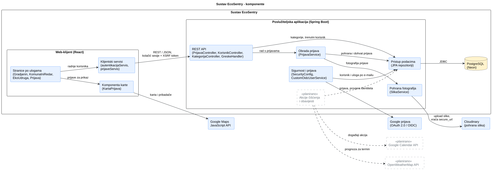
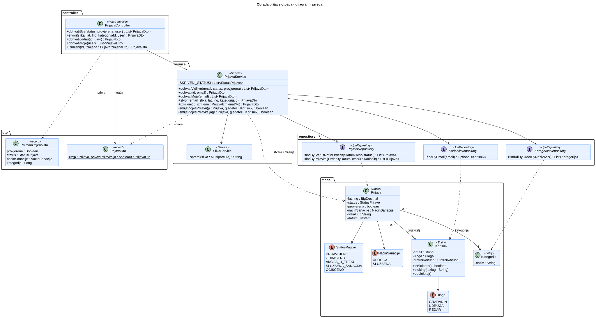

# 4. Arhitektura i oblikovanje

**Cilj:** Definirati arhitekturni stil, dekompoziciju programa na podsustave i module, organizaciju podataka te dinamičko ponašanje tijekom izvođenja. Arhitektura predstavlja temelj za implementaciju i ažurira se pri svakoj važnijoj promjeni projektnih odluka.

| Arhitekturni pogled | Ključno inženjersko pitanje | Primijenjeni model ili dijagram |
| :--- | :--- | :--- |
| **Strategija rješenja** | Koji stil i temeljne odluke određuju program? | Tablica odluka (odjeljak 4.1) |
| **Struktura podsustava** | Koji su glavni dijelovi i kako komuniciraju? | Dijagram komponenata |
| **Model podataka** | Kako su strukturirani trajni podaci programa? | Relacijski ER dijagram |
| **Struktura koda** | Kako su dodijeljene odgovornosti i ključne klase? | Reprezentativni dijagram razreda |
| **Dinamičko ponašanje** | Kako moduli surađuju pri obradi ključnih transakcija? | sekvencijski dijagram |
| **Stanja sustava** | Kako ključni domenski objekt mijenja svoja stanja? | Dijagram stanja |
| **Fizički razmještaj** | Na kojim se izvršnim čvorovima program izvodi? | Dijagram razmještaja (poglavlje 6) |

---

Za svaki UML dijagram čuvajte čitljivu sliku i PlantUML izvor, kako je opisano na stranici [Home](./Home.md). U dovršenoj stranici koristite vlastite projektne odluke i modele.

## 4.1 Ključne arhitekturne odluke

| Odluka | Razmatrana alternativa | Projektno specifično obrazloženje i kompromis |
| --- | --- | --- |
| Svi korisnici prijavljuju se isključivo Google računom (OAuth 2.0 / OpenID Connect); poslužitelj pamti prijavljenog korisnika u sesiji, a ulogu čita iz baze | Lokalni računi s lozinkom za komunalne redare | Sustav ne sprema ni ne provjerava lozinke, a uloga se ne preuzima od Googlea nego iz vlastite baze, pa poslužitelj odlučuje o pravima. Ovisimo o dostupnosti Googlea, a prvog redara treba upisati izravno u bazu. Obrazloženje je u ADR-01. |
| PostgreSQL kod upravljanog pružatelja Neon | MySQL; Supabase kao pružatelj baze | Prijave, korisnici, kategorije i akcije imaju jasne veze i ograničenja koja relacijska shema čini eksplicitnima. Neon nudi samo bazu, što odgovara aplikaciji u kojoj prijavu i API već radi Spring Boot. Besplatna baza se uspava kad nema prometa, pa prvi upit nakon pauze traje duže. Obrazloženje je u ADR-02. |
| Shemu baze vode Flyway migracije (`V1__init.sql` … `V4__test_racuni.sql`), a Hibernate je samo provjerava (`ddl-auto=validate`) | Ručno izvršavanje SQL skripti u pgAdminu | Baza je zajednička za sve članove tima i za Render, a za nju je zadužen jedan član. Svaka promjena sheme je nova datoteka u repozitoriju i automatski se primjenjuje pri pokretanju poslužitelja, pa svi imaju istu shemu i povijest promjena. Kompromis: izvršena migracija se ne smije mijenjati, nego se svaka ispravka piše kao nova migracija. |
| Fotografije prijava spremaju se izvan baze, u bazi je samo URL; ciljna pohrana je Cloudinary, a do integracije se koristi disk poslužitelja | Spremanje fotografija u bazu (`BYTEA`) | Baza ostaje mala unutar besplatne kvote Neona, a fotografije se mogu dohvaćati izravno putem URL-a. Privremena pohrana na disk Rendera gubi fotografije pri svakom novom postavljanju (vidi 4.7). Obrazloženje je u ADR-03. |
| Klijent i poslužitelj grade se i postavljaju kao jedna aplikacija: izgrađeni React klijent kopira se u Spring Boot aplikaciju, koja se postavlja kao jedna Docker usluga na Renderu | Odvojeno postavljanje klijenta i poslužitelja nije posebno razmatrano | Klijent i API dijele istu adresu, pa kolačić sesije i CSRF zaštita rade bez dodatne CORS konfiguracije, a za postavljanje je dovoljna jedna besplatna usluga i jedan `Dockerfile`. Kompromis: klijent se ne može postaviti neovisno o poslužitelju, a kvar ili ponovno pokretanje usluge zaustavlja oboje. |

## 4.2 Gradivni blokovi i UML dijagram komponenata

Sustav EcoSentry čine web-klijent u Reactu, jedna poslužiteljska aplikacija u Spring Bootu i PostgreSQL baza na Neonu. Klijent i poslužitelj grade se i postavljaju zajedno (vidi 4.1), ali su logički odvojeni: klijent komunicira s poslužiteljem samo putem REST API-ja na `/api/...`. Pravokutnici unutar poslužiteljske aplikacije prikazuju module jedne aplikacije, a ne zasebno postavljene usluge. Isprekidano su prikazani dijelovi koji su planirani, ali još nisu implementirani.

**Slika 4.1. Dijagram komponenata sustava EcoSentry**

**PlantUML izvor:** [izvor](./puml/4-1-ecosentry-system-CMP.puml)

| Komponenta | Odgovornost | Razlog za ovu granicu |
| --- | --- | --- |
| Stranice po ulogama (`frontend/src/pages`) | Nakon prijave `App.jsx` prema ulozi korisnika prikazuje stranicu `Gradjanin`, `KomunalniRedar` ili `EkoUdruga`; neprijavljeni korisnik vidi stranicu `Prijava`. Popis akcija na stranici `EkoUdruga` još prikazuje probne podatke, dok su prijave dohvaćene s poslužitelja. | Svaka uloga ima vlastiti prikaz i radnje, pa se stranice mogu razvijati neovisno. |
| Komponenta karte (`KartaPrijava.jsx`) | Prikazuje prijave kao pribadače obojane po statusu i omogućuje odabir lokacije nove prijave. | Kartu koriste sve tri uloge; Google Maps ključ i rad s kartom nalaze se na jednom mjestu. |
| Klijentski servisi (`frontend/src/services`) | Šalju zahtjeve poslužitelju s kolačićem sesije i XSRF tokenom te pretvaraju pogreške u poruke za korisnika. | Stranice ne znaju adrese ni oblik HTTP zahtjeva; rad s podacima odvojen je od prikaza. |
| Sigurnost i prijava (`SecurityConfig`, `CustomOidcUserService`) | Provodi Google prijavu, pronalazi ili stvara korisnika u bazi i dodjeljuje mu ulogu; štiti sve rute `/api/**` osim prijave i provjere ispravnosti. | Provjera identiteta i uloge odvija se na jednom mjestu, prije nego zahtjev stigne do kontrolera. |
| REST API (`controller`) | Prima HTTP zahtjeve, provjerava ulogu (`@PreAuthorize`) i vraća JSON; `GreskeHandler` sve pogreške vraća u istom obliku `{"poruka": ...}`. | HTTP sloj odvojen je od pravila obrade prijava. |
| Obrada prijava (`PrijavaService`) | Provjerava podatke nove prijave, određuje tko smije vidjeti koju prijavu i provodi dopuštene promjene statusa. | Pravila o prijavama imaju jedno mjesto odgovornosti i ne ovise o tome odakle zahtjev dolazi. |
| Pohrana fotografija (`SlikaService`) | Provjerava vrstu datoteke, sprema fotografiju pod nasumičnim imenom i vraća njezin URL. | Prelazak s diska na Cloudinary mijenja samo ovu komponentu (ADR-03). |
| Pristup podacima (`repository`) | Spring Data JPA repozitoriji za korisnike, prijave i kategorije. | Upiti prema bazi odvojeni su od poslovne logike. |
| Akcije čišćenja i obavijesti (planirano) | Organizacija akcija, prijava volontera, upis u Google kalendar, prognoza za termin i obavijesti unutar aplikacije. | Tablice za te podatke već postoje u bazi (4.3.1), a kod se dodaje kao zaseban modul. |

Vanjske usluge nalaze se izvan granice sustava. Google prijavu poziva poslužitelj, a Google Maps JavaScript API izravno preglednik. Google Calendar, OpenWeatherMap i Cloudinary još nisu povezani. Fotografije se do integracije s Cloudinaryjem spremaju u mapu `uploads/` na disku poslužitelja. Gdje se ti dijelovi stvarno izvode prikazuje [dijagram razmještaja](./6-Postavljanje-instalacija-i-konfiguracija.md).

## 4.3 Model podataka i oblikovanje razreda

### 4.3.1 ER dijagram i model podataka

Građanin podnese prijavu otpada s fotografijom, kategorijom i lokacijom. Komunalni redar je prihvati ili odbaci i odluči hoće li je čistiti eko-udruga ili komunalna tvrtka. Eko-udruga može u jednu akciju čišćenja uključiti više prijava, a građani se na akciju prijavljuju kao volonteri. Svaka promjena statusa prijave bilježi se u povijesti statusa, a korisnici o promjenama dobivaju obavijesti.

**Slika 4.2. ER dijagram podataka sustava EcoSentry**

**PlantUML izvor:** [izvor](./puml/4-2-ecosentry-data-ERD.puml)  
**Implementacija:** shema se stvara Flyway migracijama u [`backend/src/main/resources/db/migration`](../backend/src/main/resources/db/migration) (`V1__init.sql` do `V4__test_racuni.sql`); JPA entiteti nalaze se u paketu [`hr.fer.ecosentry.model`](../backend/src/main/java/hr/fer/ecosentry/model).

Važne odluke modela podataka:

- **Jedna tablica `korisnik` za sve uloge.** Uloga je stupac s vrijednostima `GRADANIN`, `UDRUGA` i `REDAR`. Naziv organizacije obavezan je samo za udruge, a razlog blokade samo za blokirane korisnike. Oba pravila provodi baza (`CHECK` ograničenja), ne samo poslužitelj.
- **Bez lozinki.** Korisnik se prepoznaje po Google identifikatoru (`id_oauth`) i e-mailu. `id_oauth` je prazan dok se unaprijed dodani redar prvi put ne prijavi; tada ga poslužitelj poveže po e-mailu (ADR-01).
- **Kategorije su zapisi u tablici**, a ne fiksne vrijednosti u kodu, pa redar može promijeniti kategoriju prijave, a popis se mijenja migracijom.
- **Statusi i uloge spremaju se kao tekstualni kodovi** (npr. `AKCIJA_U_TIJEKU`) koji odgovaraju Java enumima; prikazne nazive s dijakriticima određuje klijent.
- **Veze više-na-više** (akcija obuhvaća više prijava; korisnik volontira na više akcija) provedene su veznim tablicama `akcija_prijava` i `volonter_prijava`. Uz volontera se pamti i ID događaja u njegovom Google kalendaru.
- **`status_log` čuva povijest promjena statusa** prijave: tko je i kada promijenio status iz kojeg u koji.
- **Fotografije nisu u bazi**, nego samo njihovi URL-ovi (ADR-03).

**Razlike između modela i trenutačne implementacije:** shema baze napravljena je za cijeli odobreni opseg, a poslužitelj zasad koristi samo tablice `korisnik`, `kategorija` i `prijava`. Tablice `akcija`, `akcija_prijava`, `volonter_prijava`, `obavijest`, `status_log` i `google_token` postoje u bazi, ali još nemaju JPA entitete ni kod koji ih koristi. Status `AKCIJA_U_TIJEKU` stoga se još ne postavlja.

### 4.3.2 Reprezentativni UML dijagram razreda

Prikazano je područje obrade prijave otpada: od REST kontrolera preko usluge do entiteta i repozitorija. To je središnji dio aplikacije i dio koji je u cijelosti implementiran.

**Slika 4.3. Dijagram razreda za obradu prijave otpada**

**PlantUML izvor:** [izvor](./puml/4-3-ecosentry-domain-CD.puml)  
**Kod:** [`PrijavaController`](../backend/src/main/java/hr/fer/ecosentry/controller/PrijavaController.java), [`PrijavaService`](../backend/src/main/java/hr/fer/ecosentry/service/PrijavaService.java), [`Prijava`](../backend/src/main/java/hr/fer/ecosentry/model/Prijava.java)

Raspodjela odgovornosti:

- **`PrijavaController`** samo prevodi HTTP zahtjeve u pozive usluge i provjerava ulogu: prijavu može podnijeti samo građanin, a mijenjati samo redar (`@PreAuthorize`).
- **`PrijavaService`** sadrži pravila: koje prijave pojedina uloga vidi (odbačene i one na službenoj sanaciji vide samo redar i autor; udruga vidi samo prijave poslane udrugama), provjeru lokacije i kategorije pri podnošenju te dopuštene promjene u metodi `izmijeni`. Primjerice, prijavu se može poslati udrugama tek nakon što je redar prihvati, a odbačenoj prijavi ne može se mijenjati kategorija. Nedopuštena promjena vraća HTTP 409.
- **`Prijava`, `Korisnik` i `Kategorija`** su JPA entiteti koji odgovaraju tablicama iz 4.3.1. `Korisnik` blokadu postavlja zajedno s razlogom (`blokiraj(razlog)`, `odblokiraj()`), a baza odbija spremanje blokiranog korisnika bez razloga.
- **Repozitoriji** su sučelja; Spring Data JPA sam stvara njihove implementacije iz imena metoda.
- **DTO zapisi** (`PrijavaDto`, `PrijavaIzmjenaDto`) određuju što se šalje klijentu. Entitet se nikad ne vraća izravno, pa usluga može sakriti autora prijave korisnicima koji ga ne smiju vidjeti.
- Usluga sve ovisnosti prima kroz konstruktor (vidi 4.6).

Pravila prijelaza statusa nalaze se u `PrijavaService`, a ne u samom entitetu `Prijava`. Kad se dodaju akcije čišćenja i zatvaranje prijava, broj prijelaza će rasti, pa je jedna od mogućnosti premjestiti ta pravila u metode entiteta (npr. `prihvati()`, `odbaci()`).

## 4.4 Ponašanje tijekom izvođenja

**Cilj:** Objasniti jednu važnu interakciju među dijelovima koji se izvode i životni ciklus jednog smislenog objekta. Odaberite primjere koji otkrivaju odluke ili neuspješne putove umjesto izrade dijagrama za svaku CRUD radnju.

### 4.4.1 Reprezentativni UML sekvencijski dijagram

**Cilj:** Prikazati redoslijed poruka za jedan reprezentativni scenarij i odgovore na važnu alternativu.

**Scenarij:** [Naziv interakcije; dodajte UC ID ako postoji.]  
**sekvencijski dijagram:** [Ugradite čitljiv UML sekvencijski dijagram.]  
**PlantUML izvor:** [Poveznica na odgovarajuću `.puml` datoteku.]

<strong>Odabir lokacije, provjera valjanosti i podnošenje prijave</strong>

**Primjer — CrisisMap:** Građanin podnosi prijavu kriznog događaja nakon što ručno odabere lokaciju ili zatraži položaj uređaja. Interakcija prikazuje i što se događa kada je pristup lokaciji odbijen, podaci prijave nisu valjani ili pohrana ne uspije.

**Slika 4.4. Sekvencijski dijagram podnošenja prijave kriznog događaja**

**PlantUML izvor:** [izvor](./puml/4-4-crisismap-report-submission-SD.puml)

**Analiza primjera:** Dva načina odabira lokacije te alternative provjere i pohrane imaju različite posljedice za korisnika; usporedite ih s odgovarajućim obrascem uporabe i njegovim alternativnim tijekovima. API preglednika za lokaciju mogućnost je preglednika; web-klijent, API, usluga i pohrana odgovaraju prikazu komponenata. Odaberite grane koje pomažu objasniti scenarij vašeg projekta i završni dijagram uskladite s implementiranom interakcijom.

### 4.4.2 Reprezentativni UML dijagram stanja

**Cilj:** Prikazati važna stanja jednog domenskog objekta ili eksplicitno upravljanog načina rada sustava te događaje ili uvjete koji ih mijenjaju.

**Vlasnik stanja i razlog odabira:** [Navedite objekt ili način rada sustava, kako se njegovo stanje prepoznaje i zašto su prijelazi važni.]  
**Dijagram stanja:** [Ugradite čitljiv UML dijagram stanja.]  
**PlantUML izvor:** [Poveznica na odgovarajuću `.puml` datoteku.]

<strong>Složeno stanje sustava: koordinacija događaja i dostupnost usluge</strong>

**Primjer — CrisisMap:** Ovaj primjer ne prikazuje životni ciklus jednog domenskog objekta, nego dva neovisna aspekta stanja cijelog sustava CrisisMap. Jedna regija opisuje način koordinacije kriznog događaja, a druga opaženu dostupnost usluge. Budući da se ta dva aspekta mogu mijenjati neovisno jedan o drugome, prikazani su kao ortogonalne regije istog složenog stanja sustava.

**Slika 4.5. Dijagram stanja sustava s ortogonalnim regijama**

**PlantUML izvor:** [izvor](./puml/4-5-crisismap-system-SM.puml)

**Analiza primjera:** Vlasnik stanja u ovom je primjeru sustav CrisisMap, a ne pojedinačna prijava kriznog događaja. Dvije ortogonalne regije opisuju stanja koja vrijede istodobno: način koordinacije kriznog događaja i dostupnost usluge. Promjena stanja u jednoj regiji ne mora promijeniti stanje u drugoj; primjerice, aktivni krizni događaj može postojati dok je usluga potpuno ili djelomično dostupna.

Prijelazi imaju imenovane događaje ili uvjete, a grane nakon oporavka poslužiteljskog sustava uzimaju u obzir da pružatelj kartografskih usluga može i dalje biti nedostupan. Time primjer pokazuje situaciju u kojoj ortogonalne regije imaju stvarnu semantičku svrhu, a nisu samo način vizualnog grupiranja elemenata.

Ovo je napredniji primjer dijagrama stanja. Koristite takav oblik samo ako sustav stvarno održava dva ili više međusobno neovisnih aspekata stanja koji se mogu mijenjati istodobno. Za projekt u kojem je važan životni ciklus jednog objekta, primjerice prijave, rezervacije ili narudžbe, jednostavniji dijagram stanja tog objekta obično je prikladniji. Složenost dijagrama nije kriterij vrednovanja.

Pri završnom pregledu svaki prikazani prijelaz i uvjet usporedite s ponašanjem koje implementirana aplikacija stvarno podržava.

## 4.5 Zapisi arhitekturnih odluka

| ID | Odluka | Razmatrana alternativa | Obrazloženje i kompromis | Status |
| --- | --- | --- | --- | --- |
| ADR-01 | Prijava isključivo Google računom | Lokalni računi s lozinkom za redare | Nema pohrane lozinki; ovisnost o Googleu. | Prihvaćeno |
| ADR-02 | PostgreSQL na Neonu | MySQL; Supabase | Relacijske veze i ograničenja; baza se uspava bez prometa. | Prihvaćeno |
| ADR-03 | Fotografije izvan baze, ciljno na Cloudinaryju | Fotografije u bazi | Mala baza; do integracije s Cloudinaryjem fotografije se gube pri ponovnom postavljanju. | Prihvaćeno, djelomično provedeno |

### ADR-01: Prijava isključivo Google računom

| Polje | Zapis odluke |
| --- | --- |
| Kontekst i cilj | Zadatak traži prijavu putem OpenID Connect / OAuth 2.0. Prva inačica zahtjeva predviđala je i lozinke za komunalne redare, čije račune kreira administrator, te promjenu lozinke. Trebalo je odlučiti hoće li sustav održavati dva načina prijave. |
| Kriteriji odluke | Sustav ne smije nesigurno pohranjivati pristupne podatke; prava korisnika moraju se provjeravati na poslužitelju; opseg mora biti izvediv unutar semestra. |
| Razmatrane alternative | **Google prijava za sve korisnike:** jedan način prijave, bez lozinki u sustavu. **Google prijava za građane i lozinke za redare:** odgovara doslovnom čitanju zadatka, ali zahtijeva pohranu i sigurno sažimanje lozinki, promjenu i oporavak lozinke. |
| Odluka i obrazloženje | Svi korisnici, uključujući redare, prijavljuju se Google računom. Dogovoreno je s asistentom u prvoj iteraciji (vidi povijest promjena u [2. Analiza zahtjeva](2-Analiza-zahtjeva.md)). Poslužitelj pri prijavi pronalazi ili stvara korisnika u bazi (`CustomOidcUserService`) i dodjeljuje mu ulogu iz baze; novog redara postojeći redar dodaje upisom njegove e-mail adrese. Odrekli smo se rada bez Googlea: ako Google prijava nije dostupna, nitko se ne može prijaviti, a prvi redar upisuje se izravno u bazu. |
| Status | Prihvaćeno. |

### ADR-02: PostgreSQL na Neonu

| Polje | Zapis odluke |
| --- | --- |
| Kontekst i cilj | Aplikacija pohranjuje korisnike, prijave s lokacijama, kategorije, akcije i volontere. Baza mora biti dostupna svim članovima tima tijekom razvoja i javno postavljenoj aplikaciji, besplatno, najmanje do kraja siječnja. |
| Kriteriji odluke | Podaci imaju veze i pravila (npr. prijava ima autora i kategoriju, udruga mora imati naziv organizacije, blokirani korisnik mora imati razlog blokade) koja baza treba čuvati; besplatno korištenje; baza ne smije prestati raditi kad tim neko vrijeme ne radi na projektu; mali napor održavanja. |
| Razmatrane alternative | **MySQL:** relacijska baza sličnih mogućnosti; PostgreSQL ima bogatije provjere (`CHECK`), tipove i podršku u besplatnim upravljanim uslugama. **Supabase:** upravljani PostgreSQL uz vlastitu prijavu, pohranu datoteka i automatski API, koje aplikacija ne bi koristila jer to radi Spring Boot; besplatan projekt se nakon dulje neaktivnosti pauzira i treba ga ručno ponovno pokrenuti. **Neon:** samo upravljani PostgreSQL; nakon kratke neaktivnosti se uspava i sam se budi pri sljedećem upitu. |
| Odluka i obrazloženje | Odabran je PostgreSQL na Neonu. Relacijska shema čini veze između prijava, korisnika i akcija eksplicitnima, a Neon pokriva samo ono što aplikaciji treba i ne zahtijeva ručno ponovno pokretanje. Prihvaćeno je da prvi upit nakon pauze traje duže; zato bazen veza ne drži otvorene veze (`hikari.minimum-idle=0`). Shema se stvara Flyway migracijama. |
| Status | Prihvaćeno. |

### ADR-03: Fotografije izvan baze, ciljno na Cloudinaryju

| Polje | Zapis odluke |
| --- | --- |
| Kontekst i cilj | Svaka prijava ima fotografiju otpada (do 10 MB), a zatvaranje prijave i dokaz o sanaciji dodaju još fotografija. Trebalo je odlučiti gdje se fotografije trajno čuvaju. |
| Kriteriji odluke | Baza mora ostati unutar besplatne kvote Neona; fotografije moraju preživjeti ponovno postavljanje aplikacije; klijent ih mora moći prikazati putem URL-a. |
| Razmatrane alternative | **Fotografije u bazi (`BYTEA`):** sve na jednom mjestu, ali brzo troši prostor besplatne baze i opterećuje upite. **Disk poslužitelja:** najjednostavnije, ali Render briše disk pri svakom novom postavljanju. **Vanjska usluga Cloudinary:** trajna pohrana i dostava slika putem URL-a, uz dodatnu integraciju i ključeve. |
| Odluka i obrazloženje | U bazi se čuva samo URL fotografije (`url_fotografija`, `url_foto_sanacija`, `url_foto_dokaz`), a ciljna pohrana je Cloudinary. Dok integracija ne bude dovršena, `SlikaService` sprema fotografije u mapu `uploads/` na disku poslužitelja. Budući da baza čuva samo URL, prelazak na Cloudinary mijenja samo `SlikaService`, ne shemu baze. Do tada se fotografije gube pri svakom novom postavljanju (vidi 4.7). |
| Status | Prihvaćeno; pohrana na Cloudinary još nije provedena. |

## 4.6 Zajednička pravila oblikovanja (engl. Cross-cutting concerns)

**Cilj:** Prepoznati i opisati globalna pravila i mehanizme oblikovanja koji se primjenjujuju u više dijelova aplikacije, navesti gdje se planira primijeniti i ažurirati objašnjenje kako implementacija poprima konačan oblik. Uključite samo pravila koja su važna za ovaj projekt.

**Implementirani mehanizmi:**

| Aspekt | Mehanizam | Pravilo | Mjesto primjene |
| --- | --- | --- | --- |
| [Npr. Sigurnost] | [Npr. Autorizacija korisnika] | [Npr. Ovlasti se provjeravaju na poslužiteljskoj strani za svaki zaštićeni zahtjev; skrivanje elemenata korisničkog sučelja nije dovoljna zaštita.] | [Npr. Middleware za autorizaciju / zaštita API usmjernika.] |
| [Npr. Validacija podataka] | [Npr. Provjera ulaznih podataka] | [Npr. Geoprostorni podaci, uključujući koordinate, provjeravaju se prije pohrane.] | [Npr. Sloj za obradu zahtjeva / odgovarajuća usluga.] |

<strong>Primjer zajedničkih pravila i mehanizama</strong>

**Primjer — CrisisMap:**

| Aspekt | Mehanizam | Pravilo | Mjesto primjene |
| --- | --- | --- | --- |
| Sigurnost | Autorizacija moderiranja prijava | Ovlasti moderatora provjeravaju se na poslužiteljskoj strani prije odobravanja ili odbijanja prijave; skrivanje gumba u korisničkom sučelju nije dovoljna zaštita. | Poslužiteljski dio funkcionalnosti za moderiranje prijava. |
| Validacija podataka | Provjera lokacije prijave | Nedostajuće ili nevaljane koordinate odbijaju se prije pohrane prijave. | Obrada podnošenja prijave. |
| Aspekt | Mehanizam | Pravilo | Mjesto primjene |
| Upravljanje ovisnostima | Injektiranje ovisnosti | Objekt koji provodi poslovnu logiku ne stvara sam konkretnu implementaciju repozitorija, nego potrebnu ovisnost prima izvana. | `ReportWorkflow` prima implementaciju sučelja `ReportRepository` pri stvaranju objekta. |

**Analiza primjera:** Prvi redak pokazuje sigurnosno pravilo koje se provodi neovisno o korisničkom sučelju, a drugi pravilo provjere podataka prije pohrane. U vlastitoj dokumentaciji navedite samo aspekte koji se stvarno primjenjuju u projektu te konkretno mjesto njihove primjene.

Obrasci poput injektiranja ovisnosti (engl. Dependency Injection) ili repozitorija (engl. Repository) pripadaju ovdje samo kada ih kod stvarno koristi i kada objašnjavaju zajedničko pravilo oblikovanja. Tvrdnja „sustav koristi autentikaciju” sama po sebi ne govori čitatelju gdje se provjera provodi niti što štiti. Sigurnost, bilježenje događaja i obrada pogrešaka ne trebaju svaki zaseban pododjeljak po zadanom pravilu.

## 4.7 Arhitekturni rizici i tehnički dug

**Cilj:** Navesti stvarne tehničke ili domenske rizike i svjesno prihvaćene kompromise oblikovanja, njihove posljedice i način na koji ih tim obrađuje.

**Tehnički rizici i dug**

| Rizik ili kompromis | Posljedica | Odgovor na rizik  |
| --- | --- | --- |
| *Npr. Pohrana slika u lokalni file sustav* | *Pri ponovnom pokretanju kontejnera slike će biti izgubljene.* | *Prihvaćeni tehnički dug za demo verziju. U budućnosti planirana migracija na S3 (AWS).* |
| *Npr. Nepostojanje paginacije na API-ju* | *Moguće usporenje klijenta pri dohvaćanju velike količine podataka iz baze.* | *Ograničen broj testnih unosa. Dodavanje paginacije ostavljeno za sljedeću iteraciju.* |
|  |  |  |

**Poslovni ili domenski rizici, ako su značajni**

| Rizik | Posljedica | Odgovor na rizik |
| --- | --- | --- |
| **Jedna instanca aplikacije obrađuje prijave** | Kvar poslužitelja (hostinga) privremeno onemogućuje nove prijave. | Prihvaćeno u okviru ograničenja projekta za kolegij; tim ne tvrdi da postoji automatsko prebacivanje na pričuvni sustav (failover). |
| **Nedostupnost vanjskke kartografske usluge** | Prikaz karte može prestati raditi iako su pohranjene prijave u bazi i dalje dostupne. | Implementirana je korisniku vidljiva poruka o pogrešci uz alternativu pregleda prijava u tekstualnom obliku. |
|  |  |  |

<strong>Primjer tehničkih i domenskih rizika</strong>

**Primjer — CrisisMap, tehnički rizici:**

| Rizik ili kompromis | Posljedica | Odgovor na rizik |
| --- | --- | --- |
| Jedna instanca aplikacije obrađuje podnošenje prijava. | Kvar smještaja aplikacije privremeno onemogućuje nove prijave. | Rizik je prihvaćen za opseg projekta; ne uvodi se pričuvna instanca ni automatsko prebacivanje. |
| Vanjske kartografske usluge nisu dostupne. | Prikaz karte može prestati raditi iako su pohranjene prijave i dalje dostupne. | Karta se ne može prikazati, ali pohranjene prijave ostaju dostupne. | Aplikacija prikazuje poruku o nedostupnosti karte i omogućuje pregled prijava u tekstualnom obliku. |

**Primjer — CrisisMap, domenski rizik:** Čitatelji mogu neprovjerenu prijavu građanina zamijeniti za službeno upozorenje. Tim može u sučelju jasno razlikovati status provjere prijave i uputiti korisnike na službene izvore.

**Analiza primjera:** Prvi tehnički rizik prihvaća realistično ograničenje projekta kolegija; domenski se rizik odnosi na način na koji čitatelj tumači prijavu. Zabilježite ograničenje i realan odgovor koji pripadaju vašem projektu. Neostvarena obavezna funkcionalnost nije tehnički dug nego nedovršen opseg.

---

>**Završna provjera:** Usporedite dijagrame komponenata, podataka, razreda, sekvencijski dijagram i dijagram stanja s implementiranim kodom, ponašanjem aplikacije i stvarnim razmještajem. Ažurirajte zastarjele opise oblikovanja i objasnite svaku važnu razliku koja ostaje; poveznice na odgovarajući kod ili ispitivanja korisne su kada odgovaraju na konkretno pitanje.