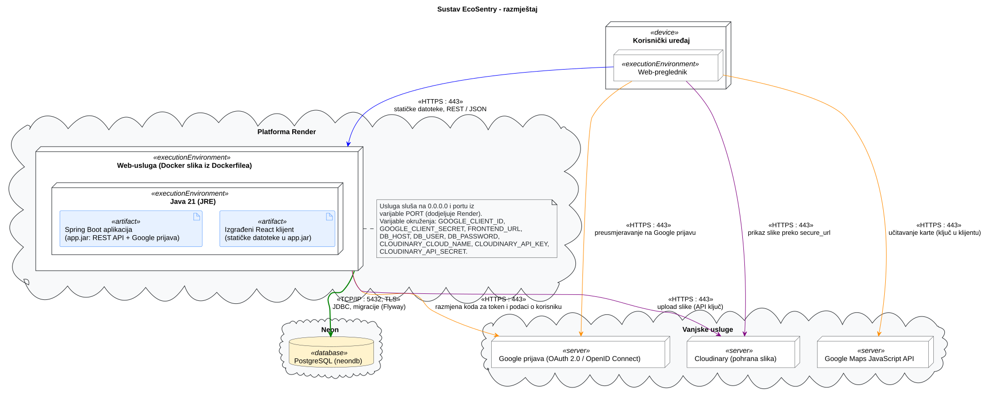

# 6. Postavljanje, instalacija i konfiguracija

**Cilj:** Detaljno dokumentirati topologiju izvođenja, postupak lokalne instalacije i konfiguracije iz izvornog koda te način javnog postavljanja i administracije programa. [README](../README.md) navodi javnu adresu i sažeti postupak lokalnog pokretanja; ova stranica donosi potpun inženjerski postupak koji osigurava točnu ponovljivost na drugom računalu.

EcoSentry se sastoji od React klijenta (`frontend/`, Vite), Java poslužitelja (`backend/`, Spring Boot) i PostgreSQL baze na usluzi Neon. Lokalno se klijent i poslužitelj pokreću kao dva procesa. Na javnoj adresi izvode se kao **jedna** Docker web-usluga na platformi Render: `Dockerfile` u korijenu repozitorija izgrađuje klijent i ugrađuje ga u poslužitelj, koji ga poslužuje uz REST API.

---

## 6.1 Prikaz razmještaja

**Cilj:** Prikazati okruženja izvođenja, raspodijeljene dijelove programa, spremište podataka i relevantne vanjske usluge.

**Dijagram razmještaja:**



**Slika 6.1. UML dijagram razmještaja sustava EcoSentry**

**PlantUML izvor:** [izvor](./puml/6-1-ecosentry-DD.puml)  
**Javno dostupna aplikacija:** https://ecosentry-6rg1.onrender.com (ista adresa navedena je u `README.md`; prije predaje provjeriti da je i dalje dostupna).

**Analiza razmještaja:**
* **Korisnički uređaj:** web-preglednik preuzima izgrađeni React klijent i izvršava ga. Kartu učitava izravno s Google Maps JavaScript API-ja.
* **Web-usluga na Renderu:** jedan proces (`java -jar app.jar`) poslužuje statičke datoteke klijenta, REST API pod putanjom `/api` i slike prijava pod putanjom `/uploads`. Klijent i API zato dolaze s iste adrese pa za javno postavljanje nije potreban CORS.
* **Baza podataka:** PostgreSQL na usluzi Neon, izvan Rendera. Veza se uspostavlja isključivo iz poslužitelja (JDBC uz `sslmode=require`), nikada iz preglednika. Shemu pri pokretanju poslužitelja stvara Flyway.
* **Slike prijava:** poslužitelj ih sprema kao datoteke u mapu `uploads/` na disku usluge, a u bazi je samo URL. Taj disk na Renderu nije trajan (vidi 6.3).
* **Google prijava:** preglednik se preusmjerava na Google, a poslužitelj od Googlea razmjenjuje kod za token i dohvaća podatke o korisniku.

---

## 6.2 Lokalna instalacija i konfiguracija

**Cilj:** Omogućiti novom članu tima ili ocjenjivaču da iz čiste radne kopije repozitorija instalira i lokalno pokrene cijeli programski sustav, uključujući bazu podataka i početne podatke.

Za pokretanje samo frontenda dovoljni su Node.js i npm: u mapi `frontend` pokreću se naredbe `npm install` i `npm run dev`, a aplikacija se otvara na adresi koju ispiše Vite. Prijava i prijave otpada traže pokrenut backend, jer frontend više ne koristi probne podatke. Stvarne tajne vrijednosti ne upisuju se u dokumentaciju ni u repozitorij.

### 1. Preduvjeti i preuzimanje izvornog koda

| Alat | Verzija | Napomena |
| --- | --- | --- |
| Git | bilo koja novija | za kloniranje repozitorija |
| JDK | 21 | `backend/pom.xml` postavlja `java.version` na 21 |
| Node.js i npm | Node.js 22 | ista verzija kao u `Dockerfile` (`node:22-alpine`) |
| Maven | nije potreban | repozitorij sadrži Maven Wrapper (`backend/mvnw`, `backend/mvnw.cmd`) |
| Baza podataka | nije potrebna lokalna instalacija | koristi se PostgreSQL na Neonu, pristupni podaci dobivaju se od tima |

```bash
git clone https://github.com/garbage-collectors-fer/garbage-collectors.git
cd garbage-collectors
```

### 2. Konfiguracijske varijable

Konfiguracija se čita iz `.env` datoteka koje se ne commitaju (`.gitignore` ih isključuje). Predlošci su u repozitoriju:

```bash
cp backend/.env.example backend/.env
cp frontend/.env.example frontend/.env
```

| Datoteka | Varijabla | Svrha | Tajna? |
| --- | --- | --- | --- |
| `backend/.env` | `GOOGLE_CLIENT_ID` | ID klijenta za Google prijavu (OAuth 2.0) | ne objavljivati |
| `backend/.env` | `GOOGLE_CLIENT_SECRET` | tajna vrijednost klijenta za Google prijavu | **da** |
| `backend/.env` | `DB_HOST` | adresa Neon baze, bez `-pooler` u imenu (pooler može stvarati probleme Flywayu) | ne objavljivati |
| `backend/.env` | `DB_USER` | korisnik baze | ne objavljivati |
| `backend/.env` | `DB_PASSWORD` | lozinka baze | **da** |
| `backend/.env` | `FRONTEND_URL` | kamo backend vraća korisnika nakon prijave; neobavezno, zadano `http://localhost:5173` | ne |
| `frontend/.env` | `VITE_GOOGLE_MAPS_API_KEY` | ključ za Google Maps JavaScript API; ulazi u izgrađeni klijent pa je vidljiv pregledniku | ne, ali ograničiti ključ u Google Cloud konzoli |
| `frontend/.env` | `VITE_API_URL` | adresa backenda, lokalno `http://localhost:8080` | ne |
| `frontend/.env` | `VITE_GOOGLE_MAPS_MAP_ID` | neobavezno; ID karte, zadano `DEMO_MAP_ID` | ne |

Vrijednosti za Google prijavu dobivaju se od člana tima zaduženog za Google OAuth (Nikola), a podaci za bazu od člana zaduženog za bazu (Pavao). Backend `.env` datoteku čita iz **radnog direktorija** (`backend/.env`) ili, ako se pokreće iz korijena repozitorija, iz `backend/.env` relativno na korijen. Preporučeno je pokretati backend iz mape `backend/`. `.env` datoteke i arhive projekta koje ih sadrže ne šalju se u Git, e-poštom ni razgovorima. Sažet vodič za lokalno pokretanje nalazi se i u datoteci `LOCAL-START-HR.md` u korijenu repozitorija.

U Google Cloud konzoli, u postavkama OAuth klijenta, mora biti dodana adresa povratka (*authorized redirect URI*):

```
http://localhost:8080/api/auth/google/callback
```

### 3. Baza podataka i početni podaci

Baza je PostgreSQL na Neonu (ime baze `neondb` zapisano je u `backend/src/main/resources/application.properties`). Lokalno se **ne stvara** nova baza: backend se spaja na zajedničku Neon bazu koju koristi tim (i javno postavljena aplikacija), pa pri lokalnom pokretanju i testiranju treba paziti da se ne brišu tuđi podaci.

Shemu i početne podatke stvara **Flyway** automatski pri svakom pokretanju backenda; ručnih naredbi nema. Verzionirane skripte su u `backend/src/main/resources/db/migration/`:

- `V1__init.sql` stvara tablice (`kategorija`, `korisnik`, `prijava`, `akcija`, `obavijest` i dr.),
- `V2__seed.sql` upisuje kategorije otpada i prvog komunalnog redara,
- `V3__nalog_kategorije_uloge.sql` uklanja službeni nalog (pravilo `ck_prijava_nalog` i stupac `nalog_broj`), svodi kategorije na četiri (Plastika, Građevinski otpad, Glomazni otpad, Ostalo) i postavlja uloge redara i udruge dvama članovima tima,
- `V4__test_racuni.sql` stvara zajedničke testne račune redara i udruge (Google računi dodani kao testni korisnici u Google Cloudu); lozinke se ne spremaju u bazu jer prijava ide preko Googlea.

Flyway izvodi svaku skriptu samo jednom, pa ponovno pokretanje ne duplicira podatke. Hibernate shemu samo provjerava (`ddl-auto=validate`), pa se pri nepodudaranju entiteta i baze backend neće pokrenuti. Neon se uspavljuje kad nema prometa, pa prvo pokretanje ili prvi zahtjev može potrajati.

**Uloge korisnika.** Svaki novi korisnik koji se prvi put prijavi Google računom dobiva ulogu građanina. Uloge redara i udruge za članove tima i testne račune već postavljaju migracije V2 do V4: redak korisnika stvara se unaprijed, a backend ga pri prvoj prijavi povezuje po e-mail adresi. Za bilo koji drugi račun ulogu redara ili udruge trenutačno se postavlja ručno u bazi (npr. u SQL uredniku na Neonu), nakon što se korisnik barem jednom prijavio:

```sql
UPDATE korisnik SET uloga = 'REDAR' WHERE email = 'adresa@example.com';

-- za udrugu je obavezan i naziv udruge (ograničenje ck_korisnik_udruga)
UPDATE korisnik SET uloga = 'UDRUGA', organizacija_naziv = 'Naziv udruge' WHERE email = 'adresa@example.com';
```

Uloga se čita iz baze pri svakoj prijavi, pa se korisnik nakon promjene mora ponovno prijaviti.

### 4. Pokretanje

Potrebna su dva terminala.

**Terminal 1 – backend (Spring Boot, `http://localhost:8080`):**

```bash
cd backend
./mvnw spring-boot:run        # Windows: mvnw.cmd spring-boot:run
```

**Terminal 2 – frontend (Vite, `http://localhost:5173`):**

```bash
cd frontend
npm install
npm run dev
```

### 5. Provjera rada

1. Backend je živ: `curl http://localhost:8080/api/health` vraća `{"status":"ok"}`.
2. Zaštita API-ja radi: `curl -i http://localhost:8080/api/me` bez prijave vraća status 401 i tijelo `{"poruka":"Korisnik nije prijavljen"}`.
3. Otvorite `http://localhost:5173`, prijavite se Google računom i provjerite da se prikazuje stranica za vašu ulogu.
4. Kao građanin podnesite probnu prijavu (slika, lokacija na karti, kategorija), provjerite da se na karti pojavljuje crvena pribadača i da prijava ostaje nakon osvježavanja stranice. To dokazuje da se podaci trajno spremaju u bazu.
5. Slika prijave nalazi se u mapi `backend/uploads/` (u bazi je samo njezin URL).
6. Odjavite se gumbom „Odjava“ i provjerite da se ponovno prikazuje stranica za prijavu.

**Ako korak ne uspije:** pogreške pokretanja i zahtjeva ispisuje terminal 1 (backend; uključen je i ispis SQL upita), a neuspjele pozive API-ja vidi se u kartici *Network* u alatima za razvojne programere preglednika. Ako se backend ne pokreće, provjerite je li `backend/.env` ispunjen i pokreće li se backend iz mape `backend/`; poruka o neuspjeloj vezi s bazom obično znači krivi `DB_HOST`, `DB_USER` ili `DB_PASSWORD`. Poruka „Prijava nije uspjela“ obično znači da adresa povratka nije dodana u Google Cloud konzoli ili da Google račun nema potvrđenu e-mail adresu.

### 6. Pokretanje automatskih testova

```bash
cd backend
./mvnw test
```

Automatizirani testovi ne trebaju pristup zajedničkoj Neon bazi ni Google računu. Repozitorijski testovi koriste testni H2 kontekst, a servisni i kontrolerski testovi izoliraju ovisnosti lažnim objektima (vidi poglavlje 5).

---

## 6.3 Javno postavljanje i administracija

**Cilj:** Dokumentirati točne korake za ponovljivo postavljanje cjelovitog programskog sustava na produkcijsku infrastrukturu u oblaku, uključujući smještenu bazu podataka i veze među postavljenim dijelovima.

| **Postavljeni podsustav** | **Infrastruktura i izvor koda** | **Naredbe izgradnje i pokretanja** | **Konfiguracija i varijable okruženja** |
| --- | --- | --- | --- |
| **Klijent i poslužitelj (jedna web-usluga)** | Render, Web Service s Docker okruženjem; repozitorij `garbage-collectors-fer/garbage-collectors`, grana `master`, korijenski `Dockerfile` | Izgradnja: `Dockerfile` u tri koraka. (1) `node:22-alpine`: `npm ci` i `npm run build` u `frontend/`. (2) `eclipse-temurin:21-jdk`: izgrađeni klijent kopira se u `src/main/resources/static`, zatim `sh mvnw -q -DskipTests package`. (3) `eclipse-temurin:21-jre`: `java -jar app.jar` | `GOOGLE_CLIENT_ID`, `GOOGLE_CLIENT_SECRET`, `DB_HOST`, `DB_USER`, `DB_PASSWORD` (tajne), `FRONTEND_URL` (javna adresa usluge), `PORT` (dodjeljuje Render), `VITE_GOOGLE_MAPS_API_KEY` (Docker build argument za izgradnju klijenta, vidljiv pregledniku) |
| **Baza podataka** | Neon (upravljani PostgreSQL), baza `neondb`; nije na Renderu | Shemu pri pokretanju poslužitelja izvodi Flyway (`db/migration/V1__init.sql` do `V4__test_racuni.sql`) | `DB_HOST` (bez `-pooler`), `DB_USER`, `DB_PASSWORD`; postavljaju se na web-usluzi, ne na klijentu |

**Što se događa u konfiguraciji:**
- `VITE_API_URL` se u Dockerfileu ne postavlja pa klijent poziva API na istoj adresi s koje je učitan, što je željeno ponašanje za jednu uslugu. Ostale `VITE_` varijable osim `VITE_GOOGLE_MAPS_API_KEY` Dockerfile ne prosljeđuje (npr. `VITE_GOOGLE_MAPS_MAP_ID` ostaje na zadanoj vrijednosti).
- `FRONTEND_URL` mora biti javna adresa usluge. Njegova zadana vrijednost je `http://localhost:5173`, pa bi bez postavke Google prijava na Renderu nakon uspjeha vratila korisnika na lokalnu adresu.
- Poslužitelj sluša na `PORT`, a postavka `server.forward-headers-strategy=framework` omogućuje ispravne `https` adrese iza Renderova proxyja.
- CORS u `SecurityConfig` dopušta samo `http://localhost:5173`. To ne smeta kad klijent i API dolaze s iste javne adrese.
- Spoj na bazu koristi `sslmode=require`, a veza se ne drži otvorenom (`minimum-idle=0`), jer Neon uspavljuje bazu kad nema prometa.

**CI i CD:** `.github/workflows/ci.yml` trenutačno samo ispisuje poruku (`echo`) i ne izvodi izgradnju ni testove, pa **se ne može smatrati kontinuiranom integracijom**. `.github/workflows/cd.yml` pri pushu na `master` poziva Render *deploy hook* samo ako je u GitHub tajnama postavljen `RENDER_DEPLOY_HOOK_URL`. Ta tajna **nije postavljena**, pa se taj korak preskače, a postavljanje pokreće Renderov vlastiti *auto-deploy* na svaki push na `master`. Budući da ne postoje automatizirane provjere koje promjena mora proći, to je automatsko pokretanje postavljanja, a ne kontinuirano postavljanje u užem smislu.

### Postupak postavljanja

1. **Baza podataka:** u Neonu je postojeći projekt s bazom `neondb`. Za produkciju se koristi grana `production`, a u `DB_HOST` adresa **bez** `-pooler`. Tablice i početne podatke stvara Flyway pri prvom pokretanju poslužitelja, pa ručna primjena sheme nije potrebna.
2. **Web-usluga:** na Renderu odabrati *New → Web Service*, povezati GitHub repozitorij, odabrati granu `master` i Docker okruženje (Render koristi `Dockerfile` u korijenu). U postavkama web-usluge postaviti `GOOGLE_CLIENT_ID`, `GOOGLE_CLIENT_SECRET`, `DB_HOST`, `DB_USER`, `DB_PASSWORD` i javnu adresu `FRONTEND_URL`. Za Google Maps ključ provjeriti da je `VITE_GOOGLE_MAPS_API_KEY` dostupan kao Docker build argument tijekom izgradnje (u Dockerfileu je deklariran `ARG`); sam ključ nije tajna, ali ga treba ograničiti po HTTP referreru i API-ju u Google Cloud konzoli.
3. **Javna adresa:** nakon prvog postavljanja zabilježiti adresu usluge (oblik `https://<naziv>.onrender.com`), postaviti je kao `FRONTEND_URL` i ponovno postaviti uslugu.
4. **Završno povezivanje:** u Google Cloud konzoli, u OAuth klijentu, dodati adresu povratka `https://<javna-adresa>/api/auth/google/callback`. Za trenutačno navedenu javnu adresu to je `https://ecosentry-6rg1.onrender.com/api/auth/google/callback`. Zatim otvoriti javnu adresu, prijaviti se Google računom, podnijeti probnu prijavu i provjeriti da se pojavljuje na karti. README već navodi `https://ecosentry-6rg1.onrender.com`; nakon promjene domene ažurirati oba dokumenta.

### Stanje produkcijskog postavljanja

| Stavka | Vrijednost |
| --- | --- |
| Naziv usluge | `ecosentry` (Render, Web Service) |
| Plan i regija | Free, Frankfurt |
| Izvor izgradnje | `./Dockerfile`, grana `master` |
| Javna adresa | https://ecosentry-6rg1.onrender.com/ |
| Postavljene varijable okruženja | `GOOGLE_CLIENT_ID`, `GOOGLE_CLIENT_SECRET`, `FRONTEND_URL`, `DB_HOST`, `DB_USER`, `DB_PASSWORD`, `VITE_GOOGLE_MAPS_API_KEY` (vrijednosti se ne dokumentiraju) |
| Google Maps ključ | Prosljeđuje se kao Docker build argument (`ARG` i `ENV` u `Dockerfileu` prije `npm run build`); Render varijable okruženja prosljeđuje Dockeru |
| Način postavljanja | Automatski deploy (*auto-deploy*) na svaki push na `master` |
| Zadnje uspješno postavljanje | 15. 11. 2026. u 20:54, commit `66cb6b5` |

Plan Free znači da Render usluga nakon razdoblja bez prometa miruje, pa prvi zahtjev nakon toga traje dulje.

### Pristup i administracija

- **Nadzor rada i zapisi pogrešaka:** zapisi poslužitelja i zapisi izgradnje vide se u Render nadzornoj ploči, u kartici *Logs* odabrane usluge. Pristup imaju članovi tima koji su dodani u Render projekt. Podaci u bazi mogu se pregledavati u Neonu.
- **Upravljanje ovlastima:** aplikacija nema administratorsko sučelje. Svaki novi korisnik postaje građanin. Prvi redar upisan je u `V2__seed.sql`, a daljnji redari, udruga i testni računi u `V3__nalog_kategorije_uloge.sql` i `V4__test_racuni.sql`; ostale promjene uloge rade se SQL naredbom u bazi (vidi 6.2, odjeljak 3). Redar u aplikaciji još ne može sam dodavati redare ni odobravati udruge.
- **Sesije:** nakon svakog novog postavljanja korisnici se moraju ponovno prijaviti.
- **Pohrana slika:** slike prijava spremaju se na disk web-usluge (`./uploads`). Na Renderu taj disk nije trajan, pa **slike nestaju pri svakom novom postavljanju ili ponovnom pokretanju usluge**, dok zapisi u bazi ostaju. Kod sadrži bilješku da će se pohrana zamijeniti vanjskom uslugom za slike; do tada je to poznato ograničenje.
- **Postupak ažuriranja:** promjena se spaja u granu `master` (po mogućnosti preko pull requesta). Push na `master` pokreće Renderov *auto-deploy* (`cd.yml` s deploy hookom se ne koristi jer tajna nije postavljena); Render ponovno izgrađuje Docker sliku, a Flyway pri pokretanju primjenjuje nove migracije. Postavljanje se može pokrenuti i ručno iz nadzorne ploče. Prije postavljanja ne izvode se automatizirane provjere.
- **Sigurnosne kopije i oporavak:** nisu posebno konfigurirani. Podaci su u upravljanoj bazi na Neonu, a postupak oporavka tim nije uspostavio ni isprobao.

